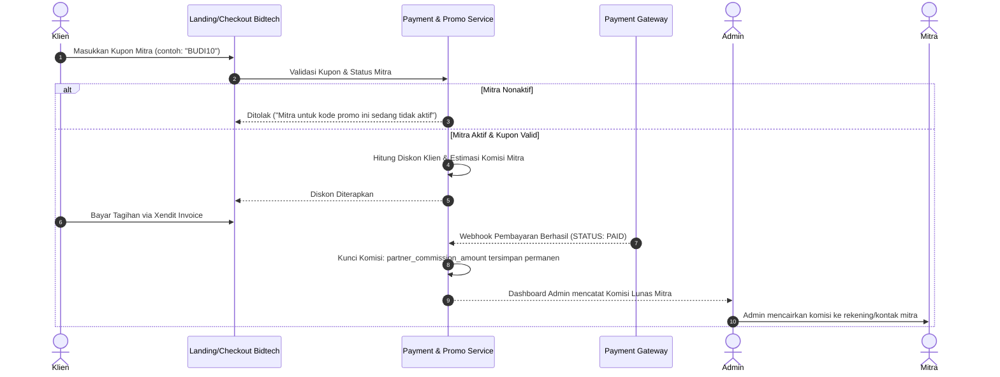

# 🤝 Panduan Penggunaan Fitur Kelola Mitra & Komisi Afiliasi Bidtech

Dokumen ini memuat panduan lengkap tata cara penggunaan fitur **Kelola Mitra, Konfigurasi Skema Komisi, Kupon Terafiliasi, serta Mekanisme Nonaktif / Hapus Mitra** pada Admin CMS Bidtech.

---

## 📌 Daftar Isi
1. [Pengantar Fitur Kemitraan](#1-pengantar-fitur-kemitraan)
2. [Akses Menu & Hak Akses](#2-akses-menu--hak-akses)
3. [Langkah 1: Menambahkan Mitra Baru](#3-langkah-1-menambahkan-mitra-baru)
4. [Langkah 2: Memahami & Mengatur Skema Komisi](#4-langkah-2-memahami--mengatur-skema-komisi)
5. [Langkah 3: Membuat & Menghubungkan Kupon ke Mitra](#5-langkah-3-membuat--menghubungkan-kupon-ke-mitra)
6. [Langkah 4: Mengedit Data & Memperbarui Komisi](#6-langkah-4-mengedit-data--memperbarui-komisi)
7. [Langkah 5: Mengaktifkan & Menonaktifkan Mitra](#7-langkah-5-mengaktifkan--menonaktifkan-mitra)
8. [Langkah 6: Menghapus Mitra & Proteksi Transaksi](#8-langkah-6-menghapus-mitra--proteksi-transaksi)
9. [Simulasi Alur Perhitungan Komisi di Checkout](#9-simulasi-alur-perhitungan-komisi-di-checkout)
10. [Tanya Jawab & Troubleshooting (FAQ)](#10-tanya-jawab--troubleshooting-faq)

---

## 1. Pengantar Fitur Kemitraan

Program kemitraan (afiliasi) Bidtech memungkinkan pihak ketiga (influencer, agensi, komunitas, atau reseller) mengajak calon klien membeli website di platform Bidtech dengan menggunakan kode kupon khusus kemitraan.

Sebagai imbalannya:
- **Klien** mendapatkan potongan harga / diskon saat checkout.
- **Mitra** mendapatkan hak komisi (rupiah atau persentase) setiap kali pesanan klien yang menggunakan kuponnya berstatus **Lunas (PAID)**.
- **Admin** dapat memantau seluruh performa redeem, total diskon, dan akumulasi komisi yang harus dibayarkan kepada mitra secara realtime.

---

## 2. Akses Menu & Hak Akses

1. Buka browser dan masuk ke Dashboard Admin Bidtech:  
   👉 `http://localhost:8000/dashboard` (atau domain production Anda).
2. Login menggunakan akun dengan role **ADMIN**.
3. Di sidebar navigasi sebelah kiri, cari kategori **ADMIN PANEL** lalu klik menu:  
   👉 **Mitra & Komisi** (`/dashboard/promos/partners`).

---

## 3. Langkah 1: Menambahkan Mitra Baru

Untuk mendaftarkan mitra afiliasi baru ke dalam sistem:

1. Pada halaman **Afiliasi Mitra & Komisi**, klik tombol hijau **`+ Tambah Mitra`** di pojok kanan atas.
2. Modal pop-up **Tambah Mitra Afiliasi Baru** akan terbuka.
3. Lengkapi formulir pendaftaran:
   - **Nama Lengkap Mitra:** Contoh: `Budi Santoso` atau `PT Agensi Digital Nusantara`.
   - **Email Mitra:** Alamat email unik untuk akun login mitra (contoh: `budi@mitra.com`).
   - **No. WhatsApp:** Nomor aktif mitra untuk komunikasi & pencairan komisi (contoh: `081234567890`).
   - **Password Akun:** Minimal 6 karakter (dapat digunakan mitra untuk login di kemudian hari).
   - **Tipe Komisi:** Pilih skema komisi yang disepakati (`Persentase (%)` atau `Nominal Tetap (Rp)`).
   - **Besar Komisi:** Masukkan nilai nominal atau persentase.
4. Klik tombol **Simpan Mitra**.
5. Sistem akan otomatis membuat:
   - Akun Pengguna pada tabel `users` dengan role `MITRA`.
   - Profil Kemitraan pada tabel `partners` dengan status langsung **Aktif**.

---

## 4. Langkah 2: Memahami & Mengatur Skema Komisi

Sistem mendukung 2 (dua) jenis skema komisi yang sangat fleksibel:

| Jenis Skema | Opsi Form | Cara Kerja | Contoh Perhitungan |
| :--- | :--- | :--- | :--- |
| **Persentase (%)** | `PERCENTAGE` | Mitra mendapatkan komisi sebesar persentase tertentu dari **subtotal pesanan klien** (sebelum dipotong diskon). | Komisi: `10%`. Subtotal Order: `Rp 2.000.000`. Komisi Mitra: `10% × Rp 2.000.000 = Rp 200.000`. |
| **Nominal Tetap (Rp)** | `FIXED` | Mitra mendapatkan komisi dalam jumlah rupiah yang selalu tetap per transaksi lunas, tanpa memandang besaran nilai transaksi. | Komisi: `Rp 150.000`. Berapapun subtotal order, mitra selalu menerima: `Rp 150.000`. |

> [!TIP]
> Input nominal rupiah pada form sudah dilengkapi pemisah ribuan otomatis (misal cukup ketik `150000` akan otomatis terformat menjadi `150.000`).

---

## 5. Langkah 3: Membuat & Menghubungkan Kupon ke Mitra

Setelah data mitra terdaftar, buatkan kode kupon promo khusus agar klien dapat menggunakannya saat checkout:

1. Pada halaman Mitra, klik tombol ungu **`Buat Promo Mitra`** (atau buka menu **Kode Promo** $\rightarrow$ **+ Buat Promo Baru**).
2. Isi formulir pembuatan promo:
   - **Kode Promo:** Tentukan kode unik (contoh: `BUDI10`, `AGENSIDIGITAL`).
   - **Nama Promo:** Contoh: `Promo Kolaborasi Bidtech x Budi`.
   - **Diskon Subtotal:** Pilih jenis potongan harga untuk klien (misal diskon Rp 100.000 atau 10%).
   - **Pemilik Kupon (Mitra):**  
     Buka dropdown *Pemilik Kupon*, lalu pilih nama mitra yang telah dibuat sebelumnya. Dropdown akan menampilkan:  
     `Budi Santoso (budi@mitra.com) • komisi 10% / order`.
3. Klik **Simpan Kode Promo**.
4. Kupon tersebut kini resmi terafiliasi dengan mitra tersebut dan akan otomatis muncul di tabel daftar mitra.

---

## 6. Langkah 4: Mengedit Data & Memperbarui Komisi

Jika terdapat pergantian kontak mitra, negosiasi ulang besar komisi, atau permintaan reset password:

1. Buka tabel di halaman **Mitra & Komisi**.
2. Pada baris mitra yang ingin diubah, klik tombol ikon pensil **Edit (Biru)** di kolom **Aksi**.
3. Modal **Edit Mitra & Atur Komisi** akan terbuka dengan data yang sudah terisi otomatis.
4. Anda dapat:
   - Mengubah Nama, Email, atau No. WhatsApp.
   - Mengubah **Tipe Komisi** (misal dari Persentase beralih ke Nominal Tetap).
   - Mengubah **Besaran Komisi** (misal menaikkan komisi dari `10%` menjadi `15%`).
   - Mengisi kolom **Password Baru** hanya jika mitra lupa password (kosongkan jika tidak ingin mengubah password).
5. Klik **Simpan Perubahan**. Perubahan komisi otomatis berlaku untuk pesanan baru berikutnya.

---

## 7. Langkah 5: Mengaktifkan & Menonaktifkan Mitra

Fitur toggle status memungkinkan admin menonaktifkan kemitraan sementara tanpa menghapus data historis maupun kode kupon yang sudah beredar.

### Cara Menonaktifkan / Mengaktifkan:
1. Di kolom **Status** pada tabel mitra, terdapat badge status:
   - 🟢 **Aktif** (Badge hijau dengan indikator aktif berdenyut).
   - ⚪ **Nonaktif** (Badge abu-abu).
2. Klik tombol status tersebut. Sistem akan langsung membalik statusnya dalam 1 klik dengan notifikasi sukses.

### Efek Saat Mitra Dinonaktifkan:
- **Proteksi Checkout Klien:** Jika seorang klien mencoba memasukkan kode kupon milik mitra yang nonaktif saat checkout, sistem akan memblokir dan menampilkan pesan:
  > *"Mitra untuk kode promo ini sedang tidak aktif."*
- **Audit Finansial Aman:** Semua riwayat pesanan terdahulu yang pernah lunas tetap tercatat rapi dan hak komisi yang sudah diperoleh tidak akan hilang.

---

## 8. Langkah 6: Menghapus Mitra & Proteksi Transaksi

Untuk menjaga konsistensi pembukuan dan integritas database, sistem Bidtech menerapkan **Proteksi Keamanan Berlapis**:

### A. Mitra yang Belum Memiliki Transaksi
- Jika mitra baru saja dibuat dan belum pernah menghasilkan pesanan/transaksi lunas:
  1. Klik tombol tempat sampah **Hapus (Merah)** pada baris mitra.
  2. Dialog konfirmasi akan terbuka.
  3. Klik **Ya, Hapus Mitra**.
  4. Kupon afiliasi yang belum pernah dipakai, profil mitra, dan akun user-nya akan terhapus bersih dari sistem.

### B. Mitra yang Sudah Memiliki Riwayat Transaksi Lunas
- Jika mitra **sudah pernah memiliki pesanan lunas**:
  1. Ketika tombol hapus diklik, modal akan menampilkan kotak peringatan kuning:
     > ⚠️ *Mitra memiliki riwayat transaksi/order! Data mitra tidak dapat dihapus permanen demi integritas laporan keuangan.*
  2. Jika tombol konfirmasi tetap ditekan, backend controller akan menolak penghapusan dengan aman:
     > *"Mitra tidak dapat dihapus karena sudah memiliki riwayat transaksi/order. Silakan nonaktifkan status mitra saja."*
  3. Admin cukup memilih opsi **Nonaktifkan** mitra.

---

## 9. Simulasi Alur Perhitungan Komisi di Checkout

Berikut adalah diagram alur bagaimana komisi mitra dihitung dari awal klien checkout hingga tercatat di laporan admin:

---

## 10. Tanya Jawab & Troubleshooting (FAQ)

### Q1: Apakah perubahan besar komisi mitra akan mengubah komisi pesanan yang sudah lunas sebelumnya?
> **Tidak.** Nilai komisi pesanan lama diarsipkan secara *snapshot* pada kolom `partner_commission_amount` di tabel `orders` saat pembayaran terjadi. Mengubah komisi mitra di dashboard hanya akan mempengaruhi transaksi-transaksi baru setelahnya.

### Q2: Bagaimana cara melihat siapa saja klien yang telah menggunakan kupon mitra tertentu?
> Cukup klik badge kode kupon yang ada di kolom **Kupon Terafiliasi** pada tabel mitra (misal klik `BUDI10 (3)`), sistem akan langsung mengarahkan Anda ke halaman **Riwayat Redeem Kupon** yang menampilkan rincian nama pembeli, email, nomor order, dan tanggal transaksinya.

### Q3: Apakah nomor WhatsApp mitra bisa langsung dihubungi dari dashboard?
> **Bisa.** Nomor WhatsApp mitra di tabel dilengkapi tautan langsung `https://wa.me/...`. Admin cukup mengklik nomor tersebut untuk langsung membuka chat WhatsApp ke mitra terkait pencairan dana atau koordinasi promo.

### Q4: Apa perbedaan "Total Diskon Diberikan" dan "Komisi (Lunas)"?
> - **Total Diskon Diberikan:** Akumulasi total potongan harga yang dinikmati oleh para klien pembeli.
> - **Komisi (Lunas):** Total uang komisi bersih yang berhak diterima oleh mitra dari seluruh order yang transaksinya sudah berstatus `PAID` (Lunas). Order yang kedaluwarsa atau belum dibayar tidak dihitung ke dalam komisi lunas.

---

*Dokumentasi ini dibuat untuk Admin Bidtech sebagai standar operasional pengelolaan mitra afiliasi.*
