# 📖 Dokumentasi Teknis & Riwayat Pembaruan Sistem (docs)

Selamat datang di direktori dokumentasi resmi platform **Bidtech**. Berkas ini berfungsi sebagai **indeks utama (README Dokumentasi)** dan rangkuman komprehensif atas seluruh pembaruan sistem, modul baru, perbaikan bug, dan optimasi performa yang telah diimplementasikan pada branch **`deny`**.

---

## 📑 Daftar Isi Dokumen Spesifik

Berikut adalah daftar panduan teknis mendalam yang tersedia di dalam direktori `docs/`:

| Dokumen | Topik & Cakupan Pembahasan |
| :--- | :--- |
| 📘 **[Dokumentasi Perubahan 14 Oktober 2026](DOKUMENTASI_PERUBAHAN_14_OKTOBER_2026.md)** | Rekapitulasi perbaikan komisi persentase mitra (tanpa domain), standarisasi rute `/dashboard/partners`, optimasi performa dashboard (hapus lag skeleton & polling), serta perataan tengah layout dashboard. |
| 🤝 **[Panduan Fitur Kelola Mitra & Komisi](PANDUAN_FITUR_KELOLA_MITRA_DAN_KOMISI.md)** | Panduan lengkap manajemen mitra afiliasi, konfigurasi skema komisi (persentase / rupiah), kupon diskon klien, proteksi data transaksi, dan toggle status aktif/nonaktif. |
| 💬 **[Panduan Broadcast WhatsApp Otomatis](PANDUAN_BROADCAST_WHATSAPP.md)** | Panduan integrasi Fonnte WhatsApp Gateway, notifikasi otomatis status pesanan lunas, domain aktif, dan penyerahan website siap kepada klien & admin. |
| 👁️ **[Dokumentasi View Counter Template Realtime](DOKUMENTASI_FITUR_VIEW_COUNTER_TEMPLATE_REALTIME.md)** | Arsitektur penghitung tayangan (*views*) template secara realtime antara frontend Next.js dan backend Laravel. |
| 📜 **[Dokumentasi Perubahan 6 Oktober 2026](DOKUMENTASI_PERUBAHAN_6_OKTOBER_2026.md)** | Riwayat integrasi modul multi-bahasa (i18n), pembaruan formulir pemesanan, dan aset visual. |
| 🔀 **[Dokumentasi Sinkronisasi Main ke Satria](DOKUMENTASI_PERUBAHAN_MAIN.md)** | Rekapitulasi integrasi cabang monorepo, pipeline CI/CD, dan migrasi konfigurasi produksi. |

---

## 🚀 Rangkuman Pembaruan Sistem pada Branch `deny`

Berikut adalah ringkasan seluruh perubahan arsitektur, fitur baru, dan perbaikan logika yang telah dikerjakan:

```mermaid
graph TD
    A[Pembaruan Sistem Bidtech - Branch deny] --> B[1. Modul Afiliasi & Kelola Mitra]
    A --> C[2. Notifikasi WhatsApp Otomatis]
    A --> D[3. Optimasi Dashboard & Kecepatan]
    A --> E[4. Pelacakan Status Pesanan]
    A --> F[5. Frontend Next.js & Modul Blog]
    A --> G[6. Testing & Validasi Finansial]

    B --> B1[Komisi Persentase Tanpa Domain]
    B --> B2[Rute Standar /dashboard/partners]
    B --> B3[Toggle Aktif/Nonaktif Mitra]

    C --> C1[Fonnte WhatsApp Gateway API]
    C --> C2[Trigger Status Paid, Domain, Ready]

    D --> D1[Pangkas Delay Skeleton 750ms ke 80ms]
    D --> D2[Pelonggaran Polling Realtime ke 10s]
    D --> D3[Perataan Tengah mx-auto Dashboard]

    E --> E1[Audit Trail OrderStatusHistory]
    E --> E2[Opsi Domain Sendiri is_own_domain]

    F --> F1[Modul Artikel & Blog SEO Dinamis]
    F --> F2[View Counter Template Realtime]

    G --> G1[16 Test PromoCalculationTest Lulus]
    G --> G2[Eliminasi Query N+1 di PromoService]
```



---

### 1. Modul Afiliasi & Kelola Mitra (`Partner` & `Coupon`)

- **Perbaikan Basis Komisi Persentase**:
  - Komisi mitra persentase kini dihitung dari **harga paket website setelah diskon klien** (`package_promo_price`), dan **tidak mengikutsertakan biaya domain**.
  - Formula:
    $$\text{Komisi Mitra} = \frac{\text{Besar Komisi (\%)} \times \text{Harga Paket Bersih Klien}}{100}$$
  - *Studi Kasus Nyata:* Paket Rp1.750.000 diskon 10% (Rp1.575.000) + Domain Rp200.000 = Total bayar Rp1.775.000. Komisi mitra 40% adalah **Rp630.000** (bukan Rp710.000).
- **Penyatuan Rute Standar `/dashboard/partners`**:
  - Menyelesaikan error `MethodNotAllowedHttpException` saat membuka `/dashboard/partners`.
  - Menjadikan `/dashboard/partners` sebagai rute resmi tunggal (`route('dashboard.partners.index')`) dan me-redirect otomatis rute lama `/dashboard/promos/partners`.
- **Fitur Status Aktif/Nonaktif Mitra**:
  - Migrasi `add_is_active_to_partners_table`.
  - Mitra dapat dinonaktifkan sementara tanpa menghapus riwayat komisi dan pesanannya. Kupon dari mitra yang dinonaktifkan otomatis ditolak pada sistem checkout.
- **Proteksi Integritas Data**:
  - Mencegah penghapusan akun mitra jika sudah memiliki riwayat redeem atau pesanan terkait.

---

### 2. Notifikasi Broadcast WhatsApp Otomatis (`WhatsappNotificationService`)

- **Integrasi Fonnte WhatsApp API Gateway**:
  - Mengirimkan pesan WhatsApp otomatis secara real-time saat status pesanan diubah oleh admin di halaman Kelola Pesanan.
- **Kategori Notifikasi**:
  1. **Pembayaran Lunas (`paid`):** Mengirimkan rincian invoice ke klien dan memberikan alert notifikasi pesanan masuk ke nomor WhatsApp admin.
  2. **Domain Aktif (`domain_active`):** Menginformasikan bahwa domain pesanan klien telah berhasil didaftarkan dan aktif.
  3. **Website Siap / Selesai (`completed`):** Mengirimkan ucapan selamat dan instruksi serah terima website ke pembeli.
- **Pencatatan Timestamp Notifikasi**:
  - Migrasi penambahan kolom `wa_paid_notified_at`, `wa_domain_active_notified_at`, dan `wa_ready_notified_at` pada tabel `orders` untuk memastikan pesan tidak terkirim ganda (*prevent duplicate broadcast*).

---

### 3. Optimasi Performa & Tata Letak Antarmuka Dashboard

- **Eliminasi Lag Skeleton Screen (Perceived Performance)**:
  - Memangkas delay artifisial skeleton screen di [`layouts/dashboard.blade.php`](../dashboard-bidtech/resources/views/layouts/dashboard.blade.php) dari **750 ms** (`setTimeout` 350ms + 400ms) menjadi **80 ms** transisi instan.
- **Pelonggaran Frekuensi Polling Realtime**:
  - Interval sinkronisasi view counter dilonggarkan dari **2,5 detik** menjadi **10 detik** (10.000 ms).
  - Mengatasi bottleneck pemblokiran request pada development server PHP lokal yang bersifat single-threaded (`php artisan serve`).
- **Eliminasi N+1 Database Query**:
  - Mengganti loop query relasi di `PromoService::partners()` menjadi 1 query SQL agregat `groupBy('coupon_id')`. Waktu eksekusi halaman turun dari **1.585 ms** menjadi **738 ms**.
- **Perataan Tengah (*Centered Layout*) Halaman Dashboard**:
  - Menambahkan kelas utilitas `mx-auto space-y-8` pada kontainer utama [`dashboard.blade.php`](../dashboard-bidtech/resources/views/pages/dashboard.blade.php) sehingga tampilan dashboard berada simetris di tengah pada monitor resolusi lebar (> 1280px).

---

### 4. Pelacakan Status & Opsi Checkout Klien

- **Audit Trail Riwayat Status Pesanan (`OrderStatusHistory`)**:
  - Migrasi tabel `order_status_histories`.
  - Mencatat rekam jejak setiap pergantian status transaksi (`pending` → `paid` → `processing` → `domain_active` → `completed` / `cancelled`), mencakup waktu perubahan, catatan, serta user admin penanggung jawab.
  - Dilengkapi tampilan antarmuka visual timeline interaktif di detail pesanan.
- **Opsi "Domain Sendiri" (`is_own_domain`)**:
  - Migrasi `add_is_own_domain_to_orders_table`.
  - Memberikan fleksibilitas bagi klien yang sudah memiliki nama domain sendiri sehingga tidak dikenakan biaya registrasi domain baru pada saat checkout.

---

### 5. Modul Blog & Artikel SEO di Frontend Next.js

- **Halaman Blog Publik**:
  - Penambahan rute blog dinamis: [`frontend/app/blog/page.tsx`](../frontend/app/blog/page.tsx) dan [`frontend/app/blog/[slug]/page.tsx`](../frontend/app/blog/[slug]/page.tsx).
- **Backend API Artikel**:
  - Controller REST API [`ArticleController.php`](../dashboard-bidtech/app/Http/Controllers/Api/ArticleController.php) untuk menyajikan data artikel aktif, kategori, thumbnail, dan konten HTML.
- **On-Demand Cache Revalidation**:
  - Handler revalidasi ISR di `frontend/app/api/revalidate/` untuk memastikan artikel yang baru diterbitkan atau diedit di dashboard langsung ter-update di frontend tanpa rebuild penuh.
- **Peningkatan SEO & Metadata**:
  - Pembaruan dinamis `sitemap.ts` untuk pengindeksan artikel otomatis di Google Search Console.

---

### 6. Ekspor Laporan & Pengujian Otomatis (*Testing*)

- **Ekspor Laporan Penjualan Excel (`OrderExportService`)**:
  - Fitur unduh laporan penjualan dinamis ke format spreadsheet (.xlsx / .csv) dengan dukungan filter rentang tanggal, status pesanan, dan mitra terkait.
- **Automated Testing Suite (PHPUnit)**:
  - `PromoCalculationTest`: Memvalidasi seluruh skenario kupon diskon (persentase, rupiah tetap, batas maksimum diskon, dan kalkulasi komisi mitra tanpa domain).
  - `CheckoutFlowTest`: Memvalidasi integritas proses transaksi checkout dari pemilihan paket hingga pembuatan invoice.
  - Seluruh pengujian berjalan sukses (**16 test passed, 100% assertions green**).

---

## 📂 Struktur Berkas Utama Terkait

```text
bidtech-landing/
├── docs/
│   ├── README.md                                      # Indeks utama dokumentasi (berkas ini)
│   ├── DOKUMENTASI_PERUBAHAN_14_OKTOBER_2026.md       # Catatan rilis teknis 14 Oktober 2026
│   ├── PANDUAN_FITUR_KELOLA_MITRA_DAN_KOMISI.md       # Panduan operasional modul mitra
│   ├── PANDUAN_BROADCAST_WHATSAPP.md                  # Panduan gateway notifikasi Fonnte WA
│   ├── DOKUMENTASI_FITUR_VIEW_COUNTER_TEMPLATE_REALTIME.md
│   ├── DOKUMENTASI_PERUBAHAN_6_OKTOBER_2026.md
│   └── DOKUMENTASI_PERUBAHAN_MAIN.md
│
├── dashboard-bidtech/                                 # Backend CMS (Laravel 11)
│   ├── app/
│   │   ├── Enums/DiscountMode.php
│   │   ├── Http/Controllers/
│   │   │   ├── KelolaMitraController.php              # Rute resmi /dashboard/partners
│   │   │   ├── KelolaUserController.php               # Manajemen user admin
│   │   │   └── Api/ArticleController.php              # REST API untuk frontend blog
│   │   ├── Models/
│   │   │   ├── OrderStatusHistory.php                 # Rekam jejak status order
│   │   │   └── Partner.php                            # Relasi mitra & komisi
│   │   └── Services/
│   │       ├── PaymentService.php                     # Logika komisi mitra bersih
│   │       ├── WhatsappNotificationService.php        # Integrasi Fonnte API
│   │       └── Export/OrderExportService.php          # Ekspor laporan Excel
│   └── resources/views/
│       ├── layouts/dashboard.blade.php                # Skeleton loading instan (80ms)
│       └── pages/dashboard.blade.php                  # Perataan tengah (mx-auto)
│
└── frontend/                                          # Client Public Web (Next.js 16)
    ├── app/blog/                                      # Modul blog & artikel dinamis
    ├── components/blog/                               # Komponen visual blog
    └── lib/api/                                       # Konsumsi REST API backend
```

---

*Dokumentasi ini dikelola secara berkala seiring dengan penambahan fitur dan pembaruan sistem di repositori `bidtech-landing`.*
