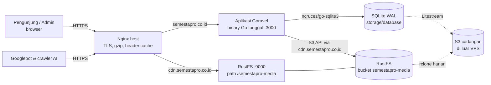

# ARCHITECTURE — Semesta Pro

> Konvensi, struktur, dan standar kualitas kode. Dokumen ini menjawab **bagaimana** membangun; **apa** yang dibangun ada di `PRD.md`, data di `SCHEMA.md`, tampilan di `DESIGN.md`.
>
> Kata **WAJIB / JANGAN / SEBAIKNYA** dipakai dengan arti tegas.

---

## 1. Gambaran sistem



- **Satu proses** aplikasi (SQLite hanya aman dengan satu penulis antar-proses yang terkoordinasi; kita tidak menjalankan replika).
- Halaman publik **dirender di server** (Go `html/template`), foto dilayani oleh RustFS lewat Nginx (rewrite ke bucket publik-baca) dengan cache panjang.
- Tidak ada CGo: SQLite (`ncruces/go-sqlite3`) dan encoder WebP (`gen2brain/webp`) memakai WebAssembly via `wazero`, sehingga build `CGO_ENABLED=0` menghasilkan binary statis.

## 2. Stack & versi

| Lapisan | Pilihan | Versi | Catatan |
|---|---|---|---|
| Bahasa | Go | ≥ 1.25 | Dibutuhkan `goravel/sqlite` |
| Framework | Goravel | v1.18.x | Driver HTTP gin |
| HTTP driver | `github.com/goravel/gin` | sesuai v1.18 | Template `html/template` + FuncMap kustom |
| Database | SQLite via `github.com/goravel/sqlite` | sesuai v1.18 | `ncruces/go-sqlite3`, WAL, lihat `SCHEMA.md` §2 |
| Storage | `github.com/goravel/s3` → RustFS | sesuai v1.18 | `endpoint`, `use_path_style` |
| Gambar | `github.com/disintegration/imaging`, `golang.org/x/image/webp` (decode), `github.com/gen2brain/webp` (encode) | terbaru stabil | tanpa CGo |
| Excel | `github.com/xuri/excelize/v2` | v2 terbaru | |
| ID | `github.com/oklog/ulid/v2` | v2 | kunci objek & `temp_uploads.id` |
| CSS | Tailwind CSS v4, CLI standalone | 4.x dipin | tanpa Node di server |
| JS | Vanilla ES modules, `<dialog>` native | – | tanpa framework, tanpa bundler |
| Ikon | Lucide (SVG inline, disalin ke `resources/views/icons/`) | dipin | lisensi ISC |
| Font | Plus Jakarta Sans, Atkinson Hyperlegible Next (woff2, self-hosted, subset latin) | – | OFL |
| Reverse proxy | Nginx (host VPS) | 1.24 | TLS via certbot/Cloudflare; konfigurasi di `deploy/nginx/` |
| Kontainer | Docker + Compose | – | `Dockerfile`, `docker-compose.yml` (dev), `docker-compose.prod.yml` (VPS) |
| Cadangan | Litestream, rclone | – | |

Menambah dependensi WAJIB dijelaskan di PR (kenapa pustaka standar tidak cukup, lisensi, ukuran).

## 3. Struktur direktori

Struktur default Goravel dipertahankan (jangan mengganti nama folder default); folder tambahan ditandai ★.

```
semestapro/
├── app/
│   ├── console/commands/         create_master.go, sweep_uploads.go, check_images.go, prune_logs.go
│   ├── domain/ ★                 aturan bisnis murni, tanpa I/O
│   │   ├── catalog/              category.go (enum 6 kategori), specs.go (definisi spesifikasi),
│   │   │                         price_ranges.go (preset harga), status.go
│   │   └── kpr/                  kpr.go (rumus anuitas + validasi)
│   ├── http/
│   │   ├── controllers/
│   │   │   ├── public/           home, search, property, staff, seo (robots, sitemap, llms, security.txt)
│   │   │   └── admin/            auth, dashboard, property, photo_upload, export, user, settings
│   │   ├── middleware/           admin_auth.go, guest_only.go, security_headers.go,
│   │   │                         robots_noindex.go, request_id.go, recover.go
│   │   └── requests/admin/       login, property, user, profile, password (form request)
│   ├── models/                   user, district, property, property_photo, temp_upload, activity_log
│   ├── policies/ ★               user_policy.go
│   ├── providers/                app, route, event, view_funcs (registrasi FuncMap & Share)
│   ├── services/ ★               logika aplikasi (memakai models & facades)
│   │   ├── listing/              service.go (create/update/delete/sold), search.go, slug.go, search_text.go
│   │   ├── media/                upload.go (orkestrasi pipeline + storage), sweep.go
│   │   ├── dashboard/            metrics.go
│   │   ├── export/               properties_xlsx.go
│   │   ├── seo/                  meta.go, jsonld.go, sitemap.go, robots.go, llms.go, securitytxt.go
│   │   ├── staff/                staff.go (memuat resources/data/staff.json)
│   │   ├── account/              user_service.go, auth_service.go
│   │   └── activity/             logger.go
│   ├── support/ ★                utilitas tanpa logika bisnis
│   │   ├── imaging/              pipeline.go (decode → orientasi → resize → WebP ≤ 300 KB)
│   │   ├── format/               rupiah.go, date.go, phone.go, area.go
│   │   ├── whatsapp/             link.go, messages.go
│   │   ├── textnorm/             slugify.go, unaccent.go
│   │   └── view/                 funcs.go, flash.go, pagination.go, errors.go
│   └── viewmodels/ ★             struct siap-render untuk template (card, detail, search page, admin rows)
├── bootstrap/app.go              setup Goravel: config, routing, middleware, callback Share
├── config/                       app, database, filesystems, http, session, cache, logging, site ★
├── database/
│   ├── migrations/               pasangan .up.sql/.down.sql tersemat di migrations/sql/, lihat SCHEMA.md D14
│   └── seeders/                  district_seeder.go, demo_seeder.go
├── public/ ★                     aset statis yang dilayani di /static
│   ├── css/app.css               HASIL BUILD (di-gitignore, dibuat di CI)
│   ├── js/                       site.js, admin.js, modules/*.js
│   ├── fonts/  img/              logo, hero, og-default.jpg, staff/*.webp, ikon favicon
├── resources/
│   ├── css/app.css               sumber Tailwind + token design system
│   ├── data/staff.json ★         data staf statis
│   └── views/                    lihat §6
├── routes/web.go                 semua rute (publik, SEO, admin)
├── storage/                      database/, framework/sessions/, logs/, app/
├── tests/                        feature/ (HTTP), unit/, fixtures/
├── docs/                         PRD, ARCHITECTURE, SCHEMA, DESIGN, design-reference/
├── deploy/ ★                     nginx/*.conf, litestream.yml
├── .air.toml  .env.example  .golangci.yml  Makefile  artisan  main.go  go.mod
```

## 4. Lapisan & arah dependensi

```
routes → controllers → services → models / facades
              ↓            ↓
          viewmodels    domain   ← (domain tidak mengimpor apa pun dari app/)
              ↓
           support (dipakai semua lapisan, tidak mengimpor services/controllers)
```

| Lapisan | Tanggung jawab | JANGAN |
|---|---|---|
| **Controller** | Ambil input, panggil form request/service, pilih respons (view, redirect, JSON, file). ≤ 40 baris per aksi. | Menulis kueri ORM, logika bisnis, format angka |
| **Form request** | Validasi struktur input dasar (wajib, panjang, format) + pesan bahasa Indonesia | Mengakses DB selain cek unik sederhana |
| **Service** | Aturan aplikasi: transaksi, invarian (maks. 8 foto, master, status terjual), event, activity log | Mengetahui HTTP (`http.Context`), merender view |
| **Domain** | Fungsi murni: definisi kategori/spesifikasi & validasinya, rumus KPR, preset harga | I/O, facades, waktu sistem (terima `time.Time` sebagai argumen) |
| **Model** | Struct ORM, scope kueri (`Available()`), relasi | Logika bisnis |
| **View model** | Mengubah model → data siap tampil (label, harga terformat, URL, ringkasan) | Kueri DB |
| **Template** | Markup, loop, kondisi tampil | Perhitungan, format manual, string bisnis yang berulang |
| **Support** | Format, slug, WhatsApp, pipeline gambar | Bergantung pada service |

Service menerima dependensi lewat constructor (`listing.NewService(db, storage, clock, logger)`) sehingga bisa diuji dengan fake. Facades boleh dipakai di constructor default (`listing.Default()`), bukan disebar di dalam fungsi.

## 5. Routing

Semua rute di `routes/web.go`. URL publik **bahasa Indonesia**, huruf kecil, kebab-case, tanpa garis miring akhir (Nginx mengalihkan `/x/` → `/x`).

### 5.1 Publik

| Metode | URL | Controller | Nama |
|---|---|---|---|
| GET | `/` | `public.Home@Index` | `home` |
| GET | `/dijual` | `public.Search@Landing` | `listings.all` |
| GET | `/dijual/{kategori}` | `public.Search@Landing` | `listings.category` |
| GET | `/dijual/{kategori}/{kecamatan}` | `public.Search@Landing` | `listings.category_district` |
| GET | `/cari` | `public.Search@Search` | `search` |
| GET | `/properti/{slug}` | `public.Property@Show` | `property.show` |
| GET | `/properti/{slug}.md` | `public.Property@Markdown` | `property.md` (C) |
| GET | `/staf` | `public.Staff@Index` | `staff.index` |
| GET | `/staf/{slug}` | `public.Staff@Show` | `staff.show` |

`{kategori}` ∈ 6 slug kategori atau `properti` (semua). `{kecamatan}` ∈ slug tabel `districts`. Nilai lain → 404. `/dijual/properti` → 301 ke `/dijual`.

### 5.2 Berkas SEO / AEO / GEO

| URL | Tipe | Cache-Control |
|---|---|---|
| `/robots.txt` | `text/plain; charset=utf-8` | `public, max-age=3600` |
| `/sitemap.xml` (indeks) | `application/xml` | `public, max-age=3600` |
| `/sitemap-pages.xml`, `/sitemap-listings.xml`, `/sitemap-staff.xml` | `application/xml` | `public, max-age=3600` |
| `/llms.txt`, `/llms-full.txt` | `text/markdown; charset=utf-8` | `public, max-age=3600` |
| `/.well-known/security.txt` | `text/plain; charset=utf-8` | `public, max-age=86400` |
| `/security.txt` | 301 → `/.well-known/security.txt` | |
| `/manifest.webmanifest` | `application/manifest+json` | `public, max-age=86400` |
| `/favicon.ico`, `/apple-touch-icon.png` | statis | 1 tahun |
| `/static/*` | statis dari `public/` | `public, max-age=31536000, immutable` (URL memakai `?v=hash`) |

### 5.3 Admin (prefix `/admin`, middleware `security_headers` + `robots_noindex`)

Form HTML hanya mendukung GET/POST, jadi aksi pengubah memakai **POST ke URL ber-kata kerja**.

| Metode | URL | Aksi | Middleware |
|---|---|---|---|
| GET/POST | `/admin/masuk` | Form & proses login | `guest_only`, throttle `login` |
| POST | `/admin/keluar` | Logout | `admin_auth` |
| GET | `/admin` | Dasbor | `admin_auth` |
| GET | `/admin/properti` | Daftar + filter | `admin_auth` |
| GET | `/admin/properti/tambah` | Form tambah | `admin_auth` |
| POST | `/admin/properti` | Simpan baru | `admin_auth` |
| GET | `/admin/properti/{id}/ubah` | Form ubah | `admin_auth` |
| POST | `/admin/properti/{id}/ubah` | Simpan perubahan | `admin_auth` |
| POST | `/admin/properti/{id}/hapus` | Hapus | `admin_auth` |
| POST | `/admin/properti/{id}/tandai-terjual` | Tandai terjual (`sold_at`) | `admin_auth` |
| POST | `/admin/properti/{id}/batalkan-terjual` | Kembali tersedia | `admin_auth` |
| GET | `/admin/properti/ekspor` | Unduh `.xlsx` (query = filter) | `admin_auth` |
| POST | `/admin/unggah-foto` | Unggah & proses 1 foto → JSON | `admin_auth`, throttle `upload` |
| GET | `/admin/pengguna` | Daftar admin | `admin_auth` |
| GET | `/admin/pengguna/tambah` | Form tambah | `admin_auth` |
| POST | `/admin/pengguna` | Simpan admin baru | `admin_auth` |
| GET/POST | `/admin/pengguna/{id}/ubah` | Ubah data admin lain | `admin_auth` + policy |
| POST | `/admin/pengguna/{id}/atur-ulang-sandi` | Set sandi baru | `admin_auth` + policy |
| POST | `/admin/pengguna/{id}/nonaktifkan` | Nonaktifkan | `admin_auth` + policy |
| POST | `/admin/pengguna/{id}/aktifkan` | Aktifkan | `admin_auth` + policy |
| GET | `/admin/pengaturan` | Profil & sandi sendiri | `admin_auth` |
| POST | `/admin/pengaturan/profil` | Simpan profil | `admin_auth` |
| POST | `/admin/pengaturan/sandi` | Ganti sandi | `admin_auth` |

Middleware global: `recover`, `request_id`, `security_headers`, CSRF (`github.com/goravel/framework/http/middleware.VerifyCsrfToken`), sesi. Middleware didaftarkan di `bootstrap/app.go` sesuai API Goravel v1.18.

## 6. View (template TMPL)

### 6.1 Organisasi berkas

```
resources/views/
├── layouts/
│   ├── public/top.tmpl        <!doctype>, <head> (partials/seo_head), skip-link, header, buka <main>
│   ├── public/bottom.tmpl     tutup </main>, CTA, footer, script
│   ├── admin/top.tmpl         <head>, sidebar, top bar, buka <main>
│   └── admin/bottom.tmpl      tutup, dialog bersama (konfirmasi/sukses/galat/loading), script
├── partials/
│   ├── seo_head.tmpl          title, meta, canonical, OG, Twitter, JSON-LD, preload font
│   ├── public/header.tmpl  public/cta.tmpl  public/footer.tmpl  public/search_bar.tmpl
│   └── admin/sidebar.tmpl  admin/flash_dialog.tmpl  admin/dialogs.tmpl
├── components/                bagian UI yang dipakai ulang (lihat DESIGN.md §8)
│   ├── property_card.tmpl  badge_status.tmpl  breadcrumb.tmpl  pagination.tmpl
│   ├── empty_state.tmpl  gallery.tmpl  spec_list.tmpl  kpr_calculator.tmpl  filter_panel.tmpl
│   ├── field_text.tmpl  field_select.tmpl  field_number.tmpl  field_textarea.tmpl
│   ├── field_checkbox.tmpl  field_category_tiles.tmpl  photo_manager.tmpl  stat_card.tmpl
├── icons/                     satu SVG per berkas: icons/whatsapp.tmpl, icons/bed.tmpl, ...
├── public/                    home, search, property_show, staff_index, staff_show
├── admin/                     login, dashboard, properties/index, properties/form,
│                              users/index, users/form, settings
└── errors/                    404, 410, 500
```

### 6.2 Aturan penamaan & komposisi

- Nama `define` **WAJIB** sama dengan path relatif berkas: `resources/views/public/home.tmpl` → `{{ define "public/home.tmpl" }}`.
- `html/template` tidak punya pewarisan layout; kita memakai pola **top/bottom**:

```gotemplate
{{ define "public/home.tmpl" }}
{{ template "layouts/public/top.tmpl" . }}

  <section class="hero" aria-labelledby="hero-title">
    <h1 id="hero-title">{{ .Page.Heading }}</h1>
    {{ template "partials/public/search_bar.tmpl" .Search }}
  </section>

  <section aria-labelledby="latest-title" class="section">
    <h2 id="latest-title">Properti Terbaru</h2>
    <ul class="grid-cards" role="list">
      {{ range .Latest }}<li>{{ template "components/property_card.tmpl" . }}</li>{{ end }}
    </ul>
  </section>

{{ template "layouts/public/bottom.tmpl" . }}
{{ end }}
```

- Setiap halaman menerima satu struct data dengan bidang standar: `.Meta` (SEO), `.Site` (kontak, nav, dari `Share`), `.Flash`, `.CSRF`, `.User` (admin), lalu bidang khusus halaman. Data dikirim sebagai `map[string]any` yang dibangun dari view model (`viewmodels.Page(...)`) agar kuncinya konsisten.
- Komponen berparameter dipanggil dengan `dict`: `{{ template "components/badge_status.tmpl" (dict "Status" .Status "Size" "lg") }}`.
- Ikon: `{{ template "icons/whatsapp.tmpl" }}`; ikon dekoratif `aria-hidden="true"`, ikon tanpa teks pendamping **dilarang**.

### 6.3 FuncMap (didaftarkan di `config/http.go` → gin `RenderOptions.FuncMap`, implementasi di `app/support/view/funcs.go`)

| Fungsi | Contoh | Hasil |
|---|---|---|
| `rupiah` | `{{ rupiah .Price }}` | `Rp 850.000.000` |
| `rupiahShort` | `{{ rupiahShort .Price }}` | `Rp 850 Juta`, `Rp 1,25 Miliar` |
| `area` | `{{ area .LandArea }}` | `120 m²` / `72,5 m²` |
| `dateID` / `dateTimeID` | `{{ dateID .CreatedAt }}` | `10 Oktober 2026` / `10 Okt 2026, 14.05 WIB` |
| `phoneID` | `{{ phoneID "+6281285552016" }}` | `0812-8555-2016` |
| `asset` | `{{ asset "css/app.css" }}` | `/static/css/app.css?v=3f9a1c2b` (hash isi berkas, dihitung saat boot) |
| `media` | `{{ media .ThumbKey }}` | URL publik media (`facades.Storage().Disk("media").Url`) |
| `waLink` | `{{ waLink .WAMessage }}` | `https://wa.me/6281285552016?text=...` |
| `jsonLD` | `{{ jsonLD .Meta.Schema }}` | `template.JS` dari `json.Marshal` |
| `nl2p` | `{{ nl2p .Description }}` | paragraf `<p>` dari teks yang sudah di-escape |
| `dict`, `list`, `add`, `sub`, `seq` | utilitas | |
| `pluralID` | `{{ pluralID 1 "properti" }}` | (bahasa Indonesia tidak berubah; tetap untuk konsistensi angka) |

### 6.4 Keamanan template

- Andalkan auto-escape `html/template`. **JANGAN** memakai `template.HTML` untuk data dari pengguna/admin. Pengecualian terkendali: `nl2p` (meng-escape dulu, baru menyisipkan `<p>`), ikon SVG statis, `jsonLD` (`json.Marshal` meng-escape `<`, `>`, `&`).
- Atribut URL dari data (mis. `maps_url`) divalidasi `https://` saat simpan.

### 6.5 Pola form admin

- **Galat validasi:** render ulang form dengan status **422**, nilai yang sudah diisi, dan `Errors map[string]string`; fokus diarahkan ke ringkasan galat di atas form (berisi tautan ke tiap kolom).
- **Sukses:** **Post/Redirect/Get** — set flash `success` (judul + pesan), redirect 303. `layouts/admin/bottom.tmpl` merender `<dialog>` sukses yang terbuka otomatis bila flash ada (FR-UX-02). Tanpa JS, flash tampil sebagai panel di atas konten.
- **Galat server:** flash `error` → dialog galat. Untuk request JSON (`/admin/unggah-foto`) kembalikan `{ "error": "pesan Indonesia" }` dengan status yang sesuai.
- CSRF: `<input type="hidden" name="_token" value="{{ .csrf_token }}">` di setiap form; request `fetch`/XHR mengirim header `X-CSRF-TOKEN` dari `<meta name="csrf-token">`.

## 7. Frontend (CSS & JS)

### 7.1 CSS

- Sumber tunggal: `resources/css/app.css` (Tailwind v4). Token design system didefinisikan di blok `@theme` sesuai `DESIGN.md` §11. **JANGAN** menulis nilai hex/px lepas di template; gunakan utilitas berbasis token atau kelas komponen.
- Kelas komponen (`.btn`, `.btn-primary`, `.field`, `.card`, `.badge-sold`, dst.) didefinisikan dengan `@layer components` agar markup tetap ringkas dan konsisten.
- Build: `tailwindcss -i resources/css/app.css -o public/css/app.css --minify` (Makefile `css`). Anggaran: ≤ 50 KB gzip.

### 7.2 JavaScript

- Berkas: `public/js/site.js` (publik, ≤ 15 KB gzip) dan `public/js/admin.js` (admin), keduanya `type="module"` dan `defer`; modul kecil di `public/js/modules/`.
- **Progressive enhancement:** semua fitur inti bekerja tanpa JS. JS dipasang via atribut data, bukan id acak:

| Atribut | Perilaku | Modul |
|---|---|---|
| `data-menu-toggle` | Buka/tutup menu mobile (`aria-expanded`) | `nav.js` |
| `data-gallery` | Galeri: tombol berlabel, geser sentuh, layar penuh (`<dialog>`), keyboard ← → Esc | `gallery.js` |
| `data-kpr` | Kalkulator KPR langsung (rumus sama dengan `app/domain/kpr`) | `kpr.js` |
| `data-filter-sheet` | Lembar filter mobile | `filters.js` |
| `data-share` | Web Share API, cadangan salin tautan | `share.js` |
| `data-confirm="<id template dialog>"` | Cegat submit/klik → dialog konfirmasi → lanjut bila "Ya" | `confirm.js` |
| `data-loading="Menyimpan…"` | Saat submit: tombol disabled + spinner + teks | `loading.js` |
| `data-photo-manager` | Unggah per foto (XHR + progres), urutkan, jadikan utama, hapus; maks. 8 | `photos.js` |
| `data-spec-fields` | Tampilkan grup spesifikasi sesuai kategori; grup tersembunyi `disabled` | `specs.js` |
| `data-unsaved-guard` | Peringatan saat meninggalkan form yang berubah | `unsaved.js` |
| `data-auto-dialog` | Buka `<dialog>` flash saat halaman dimuat | `dialogs.js` |

- **JANGAN** memakai `alert()/confirm()` bawaan browser; gunakan `<dialog>` bergaya (DESIGN.md §8.10).
- **JANGAN** menulis skrip inline (CSP). Data untuk JS dikirim lewat atribut `data-*` atau `<script type="application/json" id="...">`.

## 8. Pipeline gambar (`app/support/imaging`)

Dipanggil oleh `services/media.Upload` untuk setiap foto (FR-IMG-01…08).

```
1. Batas request: Content-Length ≤ 16 MB (middleware), berkas ≤ 15 MB.
2. Deteksi tipe dari isi (http.DetectContentType / mimetype): image/jpeg | image/png | image/webp. Lainnya → 422.
3. image.DecodeConfig → tolak bila lebar×tinggi > 50 MP atau sisi < 400 px ("Foto terlalu kecil").
4. Decode dengan orientasi EXIF (imaging.Decode(r, imaging.AutoOrientation(true))). Metadata otomatis hilang karena re-encode.
5. Ratakan alpha ke latar putih (PNG transparan).
6. Kotak target: lanskap/persegi → 1280×720; potret → 720×1280. imaging.Fit(img, W, H, imaging.Lanczos) — tidak pernah memperbesar.
7. Encode WebP lossy (gen2brain/webp, Method 4): q = 82, lalu turun 6 poin per iterasi hingga ukuran ≤ 300 KB atau q = 50.
   Masih > 300 KB pada q 50 → skala 0,85 dan ulangi dari q 70 (maks. 3 kali). Gagal → 422 "Foto tidak dapat dikompres".
8. Thumbnail dari hasil langkah 6: Fit 640×360 (potret 360×640), q 75 → ≤ 60 KB (turun 10 poin per iterasi, min 45).
9. Kembalikan {lgBytes, smBytes, width, height}. Tidak ada I/O ke storage di paket ini.
```

- Batas bawah 50 KB **tidak dipaksakan**: foto sederhana boleh lebih kecil (kualitas tidak dinaikkan secara artifisial).
- Konkurensi pemrosesan dibatasi semaphore `IMAGE_MAX_CONCURRENCY` (default 2) untuk menjaga RAM VPS (decode 50 MP ≈ 200 MB).
- Browser sebaiknya mengecilkan ke sisi terpanjang 2560 px sebelum unggah (`photos.js`, canvas), tetapi server **tidak boleh** mengandalkannya.
- Tes WAJIB dengan fixture: JPEG potret ber-EXIF orientasi 6, PNG transparan, WebP, foto 48 MP, berkas non-gambar berekstensi `.jpg`.

## 9. SEO, AEO, GEO (`app/services/seo`)

### 9.1 Struct meta

```go
type Meta struct {
    Title       string          // ≤ 60 karakter disarankan, tanpa duplikasi brand
    Description string          // 120–160 karakter
    Canonical   string          // URL absolut, tanpa query kecuali halaman
    Robots      string          // "index, follow, max-image-preview:large" | "noindex, follow"
    OGType      string          // "website" | "article"
    Image       string          // URL absolut 1200×630 atau foto 1280×720
    ImageAlt    string
    Breadcrumbs []Crumb
    Schema      []any           // objek JSON-LD
}
```

Setiap controller publik **WAJIB** mengisi `Meta`. `partials/seo_head.tmpl` merender semuanya plus `og:locale=id_ID`, `og:site_name=Semesta Pro`, `twitter:card=summary_large_image`, `theme-color`, `<link rel="alternate" type="text/markdown" href="/llms.txt">`.

### 9.2 Pola title & description

| Halaman | Title | Description |
|---|---|---|
| Beranda | `Semesta Pro — Jual Beli Rumah Secondary di Batam` | Ringkasan layanan + jumlah properti tersedia |
| `/dijual/{kat}/{kec}` | `{Kategori} Dijual di {Kecamatan}, Batam \| Semesta Pro` | `Tersedia {n} {kategori} dijual di {Kecamatan}, Batam, mulai {Rp ringkas}. Info lengkap, foto, dan status terbaru.` |
| `/dijual/{kat}` | `{Kategori} Dijual di Batam \| Semesta Pro` | idem tanpa kecamatan |
| Detail | `{Judul} — {Rp ringkas} \| Semesta Pro` (dipangkas ≤ 70) | Ringkasan otomatis (`SCHEMA.md` §7.4), ≤ 160 |
| Staf | `Staf Kami \| Semesta Pro` / `{Nama}, {Jabatan} \| Semesta Pro` | |

### 9.3 JSON-LD

| Halaman | Tipe schema.org |
|---|---|
| Semua halaman publik | `RealEstateAgent` (nama, alamat `PostalAddress`, `telephone`, `email`, `url`, `logo`, `sameAs` Instagram & Facebook, `areaServed` "Batam", `geo` bila ada) + `WebSite` dengan `SearchAction` (`/cari?q={search_term_string}`) — di beranda saja untuk `WebSite` |
| Daftar / landing | `BreadcrumbList`, `ItemList` (URL listing di halaman itu) |
| Detail | `BreadcrumbList`, `RealEstateListing` (`name`, `description`, `url`, `image[]`, `datePosted`, `offers` → `Offer` { `price`, `priceCurrency: "IDR"`, `availability`: `InStock` / `SoldOut`, `seller`: RealEstateAgent }, `about` → `SingleFamilyResidence` / `Apartment` / `House` / `Place` sesuai kategori dengan `floorSize`, `numberOfRooms`, `numberOfBedrooms`, `numberOfBathroomsTotal`, `address` (`addressLocality` kecamatan, `addressRegion` "Kepulauan Riau", `addressCountry` "ID")) |
| Detail staf | `Person` (`name`, `jobTitle`, `worksFor`, `image`, `telephone`) |

Validasi di Schema Markup Validator sebagai bagian kriteria rilis.

### 9.4 Aturan indeks & canonical

| Kondisi | `robots` | Canonical | Sitemap |
|---|---|---|---|
| Landing `/dijual/...` halaman 1 | index | dirinya | ya, bila n > 0 |
| Landing halaman > 1 (`?halaman=2`) | index, follow | dirinya (termasuk `?halaman=`) | tidak |
| Landing dengan 0 hasil | noindex, follow | dirinya | tidak |
| `/cari?...` apa pun | noindex, follow | landing bersih terdekat | tidak |
| Detail tersedia | index | `/properti/{slug}` | ya + `image:image` |
| Detail terjual | noindex, follow | dirinya | tidak |
| Admin | noindex, nofollow + header `X-Robots-Tag` | – | tidak |

### 9.5 Berkas dinamis

- **`robots.txt`**: `User-agent: *` / `Allow: /` / `Disallow: /admin`, lalu blok per crawler AI dari `config/site.go` (`ai_crawlers`: GPTBot, OAI-SearchBot, ChatGPT-User, ClaudeBot, Claude-SearchBot, Claude-User, PerplexityBot, Google-Extended, Applebot-Extended, CCBot; default `Allow`), diakhiri `Sitemap: https://semestapro.co.id/sitemap.xml`. Di `APP_ENV` selain production: `Disallow: /` untuk semua.
- **`sitemap.xml`**: indeks yang menunjuk 3 sub-sitemap. `lastmod` = `MAX(updated_at)` data terkait. Listing memakai ekstensi gambar `xmlns:image`. Dibuat dengan `encoding/xml`.
- **`llms.txt`** (format llmstxt.org):

```markdown
# Semesta Pro

> Semesta Pro (PT. Cipta Semesta Baru) adalah agen titip jual-beli properti secondary di Batam, Kepulauan Riau. Saat ini memasarkan 96 properti: rumah, ruko, apartemen, villa, gudang, dan lahan di 12 kecamatan Kota Batam. Kontak: WhatsApp 0812-8555-2016.

Harga dalam Rupiah (IDR). Properti yang sudah terjual tidak dicantumkan. Data diperbarui otomatis setiap ada perubahan.

## Kategori
- [Rumah dijual di Batam](https://semestapro.co.id/dijual/rumah): 42 properti, mulai Rp 350 juta
- ...

## Lokasi
- [Properti dijual di Sekupang](https://semestapro.co.id/dijual/properti/sekupang): 15 properti
- ...

## Halaman
- [Staf Kami](https://semestapro.co.id/staf)
- [Daftar lengkap properti (teks)](https://semestapro.co.id/llms-full.txt)

## Optional
- [Cara menghitung simulasi KPR](https://semestapro.co.id/llms-full.txt#simulasi-kpr)
```

- **`llms-full.txt`**: profil perusahaan, kontak, cara membeli/menitip, penjelasan rumus KPR, lalu **setiap properti tersedia** sebagai blok Markdown (judul, kode, URL, harga, lokasi, spesifikasi, ringkasan, deskripsi dipangkas 600 karakter), dikelompokkan per kategori.
- **`security.txt`** (RFC 9116): `Contact: mailto:<SECURITY_CONTACT>`, `Expires:` = sekarang + 365 hari (ISO 8601, dihitung saat render), `Preferred-Languages: id, en`, `Canonical: https://semestapro.co.id/.well-known/security.txt`.
- Semua berkas di atas di-cache di memori (`seo:*`) dan **dibersihkan oleh event `PropertyChanged`**.

## 10. Autentikasi, otorisasi, keamanan

### 10.1 Sesi & login

- Driver sesi **file**; cookie `semestapro_session`: `HttpOnly`, `Secure` (production), `SameSite=Lax`, umur 8 jam idle.
- Login sukses: regenerasi ID sesi, simpan `user_id` dan `session_version`, update `last_login_at`, log `auth.login`.
- `admin_auth` middleware per request: muat user; bila tidak ada / `is_active = 0` / `session_version` beda → hapus sesi, redirect `/admin/masuk` dengan pesan.
- Throttle `login`: 5 percobaan gagal / 15 menit per `ip|email` (RateLimiter Goravel atau penghitung di cache). Throttle `upload`: 60 / menit per user.
- Kata sandi: `facades.Hash()`; validasi 8–72 byte; tolak bila sama dengan email.

### 10.2 Otorisasi

- Semua aturan akun ada di `app/policies/user_policy.go` (`CanEdit`, `CanResetPassword`, `CanDeactivate`, `CanActivate`) dan dipanggil di **service** (`account.UserService`), sehingga controller mana pun tidak bisa melewatinya. Pelanggaran → `ErrForbidden` → HTTP 403 + dialog galat.
- Tes fitur WAJIB: admin biasa mengirim POST langsung ke `/admin/pengguna/{masterID}/ubah|atur-ulang-sandi|nonaktifkan` → 403 dan data tidak berubah.

### 10.3 Header keamanan (`security_headers`)

```
Strict-Transport-Security: max-age=31536000; includeSubDomains   (production)
Content-Security-Policy: default-src 'self'; img-src 'self' https://cdn.semestapro.co.id data:; script-src 'self'; style-src 'self'; font-src 'self'; connect-src 'self'; frame-ancestors 'none'; base-uri 'self'; form-action 'self'; object-src 'none'
X-Content-Type-Options: nosniff
Referrer-Policy: strict-origin-when-cross-origin
Permissions-Policy: camera=(), microphone=(), geolocation=()
```

`frame-ancestors 'none'` berlaku di seluruh situs (tidak ada kebutuhan embed).

### 10.4 Lain-lain

- Semua input divalidasi di server; panjang maksimum sesuai `SCHEMA.md`.
- Unggahan: lihat §8. Tidak pernah menyimpan berkas asli.
- `.env` tidak pernah di-commit; `APP_KEY` unik per lingkungan.
- Log tidak boleh memuat kata sandi, token CSRF, isi cookie.

## 11. Event, cache, transaksi

- `listing.Service` memancarkan event `PropertyChanged{ID}` setelah commit pada create/update/delete/sold/unsold. Listener: hapus cache `catalog:*` dan `seo:*`.
- Cache memakai driver **memory** (satu proses). TTL cadangan 10 menit.
- Operasi yang menyentuh beberapa tabel (simpan properti + foto, ubah urutan foto, hapus) **WAJIB** dalam satu transaksi `facades.Orm().Transaction(...)`. Penghapusan objek storage dilakukan **setelah** commit.
- Halaman HTML publik: `Cache-Control: no-cache` (selalu revalidasi) agar status terjual langsung terlihat (PRD §2). ETag lemah dari hash konten SEBAIKNYA ditambahkan.

## 12. Galat & logging

- Galat dibungkus dengan konteks operasi: `return fmt.Errorf("listing.MarkSold id=%d: %w", id, err)`.
- Galat domain bernama di paket terkait: `listing.ErrNotFound`, `listing.ErrTooManyPhotos`, `account.ErrForbidden`, `account.ErrMasterProtected`, `kpr.ErrInvalidRate`. Controller memetakan ke status HTTP dengan `errors.Is`.
- Log satu kali di batas HTTP (middleware `recover` + handler galat) melalui `facades.Log()` dengan `request_id`, `user_id`, rute. Level: `Error` untuk 5xx, `Warning` untuk kegagalan hapus objek/storage, `Info` untuk aktivitas admin penting.
- Halaman galat: `errors/404.tmpl`, `errors/410.tmpl` ("Properti ini sudah tidak tersedia"), `errors/500.tmpl` — semuanya memakai layout publik dan tidak menampilkan detail teknis.

## 13. Pengujian

| Jenis | Lokasi | Cakupan WAJIB |
|---|---|---|
| Unit (domain/support) | `app/domain/**/_test.go`, `app/support/**/_test.go` | Rumus KPR (vektor uji, bunga 0 → galat), validasi spesifikasi semua kategori (wajib/opsional/tidak berlaku), format rupiah & tanggal, slugify, pesan WhatsApp, pipeline gambar |
| Service | `app/services/**/_test.go` dengan SQLite berkas sementara + storage fake | Aturan status terjual, maks. 8 foto, kode listing berurutan & 410, `search_text`, policy master, metrik dasbor, ekspor (buka ulang xlsx & cek header/nilai) |
| Feature HTTP | `tests/feature/` (Goravel HTTP testing) | Rute publik 200/301/404/410, properti terjual tidak muncul di `/`, `/cari`, sitemap, `llms.txt`; meta & JSON-LD ada; alur admin login→tambah→tandai terjual; CSRF ditolak tanpa token; proteksi master |
| Manual/rilis | checklist PRD §11 | Lighthouse, uji pengguna 50+, perangkat nyata |

Vektor uji KPR (juga dipakai sebagai komentar di `kpr.js`):

| Harga | DP % | Bunga % | Tenor | Cicilan |
|---|---|---|---|---|
| 850.000.000 | 20 | 7,5 | 180 | 6.303.685 |
| 500.000.000 | 10 | 9 | 240 | 4.048.767 |
| 1.250.000.000 | 30 | 6,25 | 120 | 9.824.509 |
| 850.000.000 | 20 | 0 | 180 | galat `kpr.ErrInvalidRate` |

(Dihitung dengan rumus anuitas `PRD.md` §6.4.2, dibulatkan ke atas ke rupiah. Hitung dalam `float64` lalu `math.Ceil`; JS memakai `Math.ceil` dengan rumus yang sama.)

Target cakupan: ≥ 80% untuk `app/domain`, `app/services`, `app/support`.

## 14. Standar kualitas kode

- `gofmt`/`goimports` wajib. `go vet` bersih. `golangci-lint` dengan linter: `errcheck`, `govet`, `staticcheck`, `revive`, `gosec`, `bodyclose`, `sqlclosecheck`, `errorlint`, `gocritic`, `misspell`, `unparam`, `gocyclo` (maks. 15).
- Fungsi ≤ 50 baris (kecuali tabel data), berkas ≤ 400 baris; pecah bila lebih.
- Nama: paket huruf kecil satu kata (`listing`, `imaging`); tipe ekspor jelas (`PropertyCard`, bukan `PC`); boolean diawali `Is/Has/Can`.
- Komentar untuk **mengapa**, bukan apa. Setiap tipe/fungsi ekspor di `domain`, `services`, `support` punya doc comment.
- Tanpa variabel global yang bisa diubah, kecuali registry yang diinisialisasi saat boot (FuncMap, definisi spesifikasi) dan dibaca saja setelahnya.
- `context.Context` diteruskan ke storage & DB untuk operasi yang bisa lama.
- Konstanta bisnis (maks. foto, ukuran, batas harga) di satu tempat (`app/domain/catalog`, `config/site.go`), tidak diulang sebagai angka ajaib.
- Template: indentasi 2 spasi, satu komponen per berkas, tanpa logika selain `if/range/with/template`.
- JS: ES2020+, `const`/`let`, tanpa dependensi, setiap modul mengekspor `init(root)` dan aman dipanggil berulang.
- CSS: utilitas Tailwind berbasis token; kelas komponen untuk pola berulang ≥ 3 kali.

## 15. Konfigurasi (`.env`)

```dotenv
APP_NAME="Semesta Pro"
APP_ENV=production            # local | staging | production
APP_KEY=                      # ./artisan key:generate
APP_DEBUG=false
APP_URL=https://semestapro.co.id
APP_HOST=127.0.0.1
APP_PORT=3000

DB_CONNECTION=sqlite
DB_DATABASE=storage/database/semestapro.db

# Foto selalu memakai disk "media" (RustFS); disk default tetap local.
FILESYSTEM_DISK=local
MEDIA_KEY=
MEDIA_SECRET=
MEDIA_REGION=us-east-1
MEDIA_BUCKET=semestapro-media
MEDIA_ENDPOINT=https://cdn.semestapro.co.id
MEDIA_URL=https://cdn.semestapro.co.id/semestapro-media
MEDIA_USE_PATH_STYLE=true

SESSION_DRIVER=file
SESSION_LIFETIME=480

SITE_WHATSAPP=6281285552016
SITE_PHONE_DISPLAY=0812-8555-2016
SITE_EMAIL=darsonhutagalung20@gmail.com
SITE_ADDRESS="Komp. Ruko Tanah Mas Blok C No.6, Sei Panas, Batam 29444"
SITE_MAPS_URL=https://maps.app.goo.gl/cs7yhZyvHdCoqpij7
SITE_INSTAGRAM=https://www.instagram.com/semestapro.perty/
SITE_FACEBOOK=https://www.facebook.com/p/SemestaPro-Batam-PT-Cipta-Semesta-Baru-61560938402647/
SECURITY_CONTACT=security@semestapro.co.id
KPR_DEFAULT_RATE=7.5
KPR_DEFAULT_DP=20
KPR_DEFAULT_TENOR_MONTHS=180
AI_CRAWLERS_ALLOWED=true

IMAGE_MAX_CONCURRENCY=2
```

Disk `media` di `config/filesystems.go`:

```go
"media": map[string]any{
    "driver": "custom",
    "via": func() (filesystem.Driver, error) {
        return s3facades.S3("media") // github.com/goravel/s3/facades; ikuti berkas hasil package:install
    },
    "key":            config.Env("MEDIA_KEY"),
    "secret":         config.Env("MEDIA_SECRET"),
    "region":         config.Env("MEDIA_REGION", "us-east-1"),
    "bucket":         config.Env("MEDIA_BUCKET"),
    "url":            config.Env("MEDIA_URL"),
    "endpoint":       config.Env("MEDIA_ENDPOINT"),
    "use_path_style": config.Env("MEDIA_USE_PATH_STYLE", true),
    // object_canned_acl dikosongkan: jangan mengandalkan ACL objek; akses publik lewat bucket policy
},
```

Instal paket dengan `./artisan package:install github.com/goravel/s3` dan `./artisan package:install github.com/goravel/sqlite`, lalu sesuaikan blok konfigurasi yang dihasilkan dengan nilai di atas.

## 16. Deploy

- **Build:** `Dockerfile` multi-stage (Go 1.25 + Tailwind standalone → `alpine`, user non-root, `CGO_ENABLED=0`). GitHub Actions (`.github/workflows/deploy-semestapro.yml` (di root repositori)) menjalankan lint + test lalu membangun dan mendorong image ke GHCR (`ghcr.io/<owner>/semestapro:latest` dan `:<sha>`). VPS **tidak** membangun image.
- **Server:** VPS bersama (lihat catatan infrastruktur), direktori `/opt/semestapro` berisi `docker-compose.prod.yml` dan `.env` (tidak masuk Git). Aplikasi berjalan sebagai container `semestapro-app`, port host `127.0.0.1:3050` → 3000, `restart: unless-stopped`, batas memori 512 MB, healthcheck `/healthz`.
  ```bash
  docker compose -f docker-compose.prod.yml pull
  docker compose -f docker-compose.prod.yml up -d --wait
  docker compose -f docker-compose.prod.yml exec app ./semestapro artisan migrate --force
  ```
- **Secret & variable GitHub** (Settings → Secrets and variables → Actions; environment `production`):

  Konvensi: yang khusus Semesta Pro diawali `SEMESTAPRO_`; `SSH_*` dipakai bersama proyek lain.

  | Jenis | Nama di GitHub | Isi |
  |---|---|---|
  | Secret | `SSH_HOST`, `SSH_USER`, `SSH_PRIVATE_KEY`, `SSH_PORT` (opsional) | Bersama: akses SSH ke VPS |
  | Secret | `SEMESTAPRO_APP_KEY` | Tepat 32 karakter (Goravel, bukan format Laravel `base64:`): `openssl rand -hex 16`. Buat sekali; jangan diganti setelah ada sesi/data terenkripsi |
  | Secret | `SEMESTAPRO_MEDIA_KEY`, `SEMESTAPRO_MEDIA_SECRET` | Access key RustFS khusus bucket `semestapro-media` |
  | Variable (opsional) | `SEMESTAPRO_MEDIA_ENDPOINT` | Endpoint S3 RustFS; bawaan `https://cdn.semestapro.co.id` |
  | Variable (opsional) | `SEMESTAPRO_APP_URL`, `SEMESTAPRO_MEDIA_URL`, `SEMESTAPRO_MEDIA_BUCKET` | Bawaan `https://semestapro.co.id`, `https://cdn.semestapro.co.id/semestapro-media`, `semestapro-media` |
  | Variable (opsional) | `SEMESTAPRO_SITE_WHATSAPP`, `SEMESTAPRO_SITE_PHONE_DISPLAY`, `SEMESTAPRO_SITE_EMAIL`, `SEMESTAPRO_SECURITY_CONTACT` | Kosong = nilai bawaan `config/site.go` |

  `GITHUB_TOKEN` otomatis (push/pull GHCR). Alur: test → build + smoke test → push GHCR (`:sha`, `:latest`) → artefak `deploy-config` → scp ke `/opt/semestapro` → `scripts/render_env.py` merender `.env` di VPS → `pull` → `artisan migrate` + `db:seed` → `up -d --wait` (rollback tag bila tidak sehat; migrasi hanya maju) → `scripts/smoke.sh` lokal dan publik. Nginx **tidak** di-reload otomatis; berkas contoh disalin ke `/opt/semestapro/deploy/nginx/`.
- **Data:** volume bernama tetap `semestapro_data` (SQLite, sesi, log) dan `name: semestapro` pada Compose agar volume tidak "hilang" bila nama proyek berubah. Jangan jalankan `docker volume prune`.
- **Nginx host** (`deploy/nginx/`):
  - `semestapro.co.id.conf` → proxy ke `127.0.0.1:3050`, gzip, redirect `www` → apex dan HTTP → HTTPS, hapus garis miring akhir, `client_max_body_size 20m`, cache `immutable` untuk `/static/`.
  - `cdn.semestapro.co.id.conf` → endpoint S3 **dan** host foto publik: hanya path `/semestapro-media/...` yang diteruskan ke RustFS `127.0.0.1:9000` (`Host` tidak diubah karena SigV4 menandatanganinya); sisanya 404 karena RustFS dipakai bersama proyek lain. Cache `immutable` hanya untuk GET/HEAD.
  - `rustfs.semestapro.co.id.conf` → konsol web RustFS (`127.0.0.1:9001`, WebSocket). Konsol ini mengelola **seluruh** instans RustFS, jadi lindungi dengan Cloudflare Access dan/atau `allow`/`deny` IP.
- **Akses app → RustFS:** lewat endpoint publik `https://cdn.semestapro.co.id` (path-style), seperti pola `media.bidtech.co.id`; container tidak perlu bergabung ke jaringan Docker RustFS. Konsekuensinya API S3 terbuka ke internet (tulis tetap butuh access key; baca anonim hanya `listings/*`).
- **RustFS:** instans yang sudah berjalan di VPS (Docker, `/opt/rustfs`, S3 `:9000`, console `:9001`) dipakai bersama proyek lain, jadi buat **bucket `semestapro-media` dan access key khusus** (hanya bucket itu). Pasang bucket policy baca-anonim hanya untuk `listings/*` (mis. `mc anonymous set download` atau policy JSON `s3:GetObject`); tulis tetap butuh kunci. Verifikasi perilaku policy pada versi RustFS yang terpasang.
- **Migrasi saat rilis:** cadangkan dulu (snapshot `.backup`), `exec app ./semestapro artisan migrate --force`, lalu `up -d --wait`.
- **Scheduler** (Goravel task scheduling, berjalan di proses yang sama): `app:sweep-uploads` tiap jam, checkpoint WAL + `PRAGMA optimize` 03:00 WIB, `app:prune-logs` bulanan, `app:check-images` mingguan (laporan saja).
- **Litestream** sebagai service Compose opsional (profil `backup`) mereplikasi `semestapro.db` ke S3 **di luar VPS** (`deploy/litestream.yml`); replika di disk yang sama bukan cadangan.
- **Pemantauan:** uptime check `/` dan `/robots.txt`; peringatan disk > 80%.

## 17. Alur kerja Git

- Cabang: `main` (selalu dapat dirilis), fitur `feat/<ringkas>`, perbaikan `fix/<ringkas>`.
- Conventional Commits: `feat(search): add district filter (FR-SRC-05)`.
- PR WAJIB: deskripsi, ID PRD, tangkapan layar untuk perubahan UI (390 px & 1440 px), hasil `make lint && make test`.
- CI: lint, test, build CSS, build binary.

## 18. Anggaran kinerja

| Metrik | Target |
|---|---|
| TTFB HTML (server) | < 300 ms p95 |
| LCP (4G, mobile) | < 2,5 s |
| CSS | ≤ 50 KB gzip |
| JS publik | ≤ 15 KB gzip |
| Font | ≤ 2 keluarga, ≤ 4 berkas woff2, `font-display: swap`, preload 1 berkas body |
| Foto besar / thumbnail | ≤ 300 KB / ≤ 60 KB |
| Kueri per halaman publik | ≤ 5 (tanpa N+1; foto sampul di-join) |

## 19. Riwayat perubahan

| Versi | Tanggal | Perubahan |
|---|---|---|
| 1.0 | 2026-10-13 | Dokumen awal |
