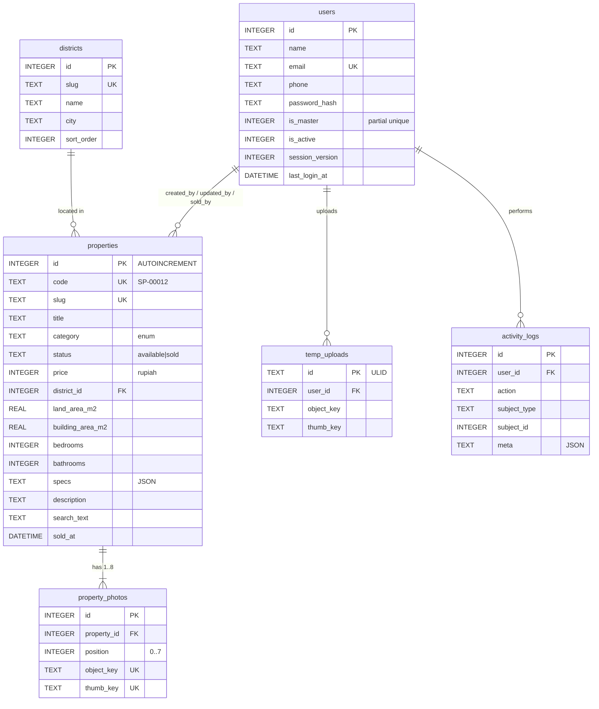

# SCHEMA — Semesta Pro

> Desain basis data (SQLite, mode WAL), struktur JSON spesifikasi, skema kunci object storage (Garage), dan kueri penting, lengkap dengan alasan keputusan desainnya. Kebutuhan fungsional ada di `PRD.md`; cara mengakses data dari kode ada di `ARCHITECTURE.md`.

---

## 1. Prinsip desain

| # | Keputusan | Alasan |
|---|---|---|
| D1 | **SQLite tunggal, mode WAL**, satu proses aplikasi | Volume kecil (±500 listing/tahun, beberapa admin). WAL memungkinkan banyak pembaca bersamaan dengan satu penulis, tanpa server DB terpisah. Biaya & operasional minimal. |
| D2 | **Harga dalam `INTEGER` rupiah** | Tidak ada galat pembulatan float. `int64` cukup hingga 9,2 × 10¹⁸. |
| D3 | **Kategori = enum `TEXT` + `CHECK`**, bukan tabel | Kategori tetap menurut klien. Enum di kode memberi type-safety dan mencegah kategori liar. Menambah kategori = migrasi + perubahan kode yang disengaja. |
| D4 | **Kecamatan = tabel `districts`** | Data referensi yang mungkin bertambah (kota lain di masa depan), butuh slug & nama tampilan, dipakai untuk landing SEO. |
| D5 | **Kolom umum dipromosikan, sisanya JSON `specs`** | Luas tanah/bangunan, kamar tidur, kamar mandi tampil di kartu & ringkasan dan berpotensi difilter → kolom nyata ber-indeks. Spesifikasi khusus kategori (sertifikat, IPL, tinggi plafon, dll.) jarang dikueri → JSON tervalidasi, tanpa puluhan kolom NULL. |
| D6 | **`id` `AUTOINCREMENT`**, kode listing `SP-00012` dari id | Id tidak pernah dipakai ulang, sehingga kode yang hilang pasti berarti **dihapus** → server mengembalikan **410 Gone** tanpa tabel tambahan. |
| D7 | **Hapus properti = hard delete** | Klien meminta hapus; jejak tetap ada di `activity_logs`. Status `sold` dipakai untuk menyembunyikan tanpa menghapus. |
| D8 | **Akun admin tidak dihapus**, hanya `is_active = 0` | Menjaga integritas FK `created_by`, `sold_by`, dan log. |
| D9 | **Tepat satu master** lewat *partial unique index* | Ditegakkan di DB, bukan hanya di aplikasi. |
| D10 | **Foto: DB menyimpan kunci objek**, berkas di Garage | DB tetap kecil; foto dilayani langsung oleh Garage/reverse proxy dengan cache panjang. |
| D11 | **Kunci objek foto bersifat permanen & acak** (tidak mengandung id properti) | Tidak perlu memindahkan objek saat unggahan sementara dilampirkan; URL bisa di-cache selamanya (`immutable`). |
| D12 | **Waktu disimpan UTC**, ditampilkan `Asia/Jakarta` | Konsisten; batas "bulan ini" dihitung di Go dalam WIB lalu dikonversi ke UTC untuk kueri. |
| D13 | **Kolom `search_text` ter-normalisasi** + `LIKE` | Cukup cepat untuk < 10.000 baris. FTS5 (tersedia di build ncruces) disiapkan sebagai peningkatan bila data membesar (§9). |
| D14 | **Migrasi ditulis sebagai SQL mentah**: pasangan berkas `database/migrations/sql/{timestamp}_{nama}.up.sql`/`.down.sql` (tersemat `go:embed`, pernyataan dipisah baris `--;;`) dijalankan lewat `facades.Schema().Sql()` | SQLite membutuhkan `CHECK`, *partial index*, dan pembuatan ulang tabel untuk mengubah constraint; SQL eksplisit lebih terkontrol dan menjadi dokumentasi. |

---

## 2. Konfigurasi koneksi SQLite

Berkas: `storage/database/semestapro.db` (bersama `-wal` dan `-shm`; ketiganya jangan di-commit).

DSN (driver `ncruces/go-sqlite3`, di `config/database.go` kunci `dsn`):

```
file:storage/database/semestapro.db?_pragma=journal_mode(WAL)&_pragma=busy_timeout(5000)&_pragma=foreign_keys(1)&_pragma=synchronous(NORMAL)&_pragma=temp_store(MEMORY)&_pragma=cache_size(-16000)&_txlock=immediate
```

| PRAGMA / opsi | Nilai | Alasan |
|---|---|---|
| `journal_mode` | `WAL` | Pembaca tidak memblokir penulis dan sebaliknya. Persisten di berkas DB. |
| `busy_timeout` | `5000` ms | Penulis kedua menunggu, bukan langsung gagal `SQLITE_BUSY`. |
| `foreign_keys` | `1` | Per koneksi; tanpa ini FK tidak ditegakkan. |
| `synchronous` | `NORMAL` | Aman untuk WAL (tidak korup saat crash; paling buruk kehilangan transaksi terakhir saat listrik padam), jauh lebih cepat dari `FULL`. |
| `temp_store` | `MEMORY` | Sort/temp lebih cepat. |
| `cache_size` | `-16000` (≈16 MB) | Cukup untuk seluruh data panas. |
| `_txlock` | `immediate` | Transaksi tulis mengambil kunci di awal → mencegah *deadlock upgrade* `SQLITE_BUSY` saat dua transaksi baca lalu tulis. |

Pool: `max_open_conns = 8`, `max_idle_conns = 8`, `conn_max_lifetime = 0`.

**Pemeriksaan saat boot (wajib):** aplikasi menjalankan `PRAGMA journal_mode;` dan `PRAGMA foreign_keys;` setelah koneksi dibuka; bila hasilnya bukan `wal` / `1`, aplikasi **gagal start** dengan pesan jelas. Ini melindungi dari driver yang mengabaikan DSN.

**Pemeliharaan:** `PRAGMA optimize;` dijalankan saat shutdown dan via scheduler harian; `PRAGMA wal_checkpoint(TRUNCATE);` harian pukul 03:00 WIB.

---

## 3. Diagram relasi



Sesi login disimpan oleh driver sesi **file** Goravel (`storage/framework/sessions`), bukan di SQLite, untuk menghindari penulisan DB pada setiap permintaan.

---

## 4. Tabel

### 4.1 `users` — akun admin

```sql
CREATE TABLE users (
    id               INTEGER PRIMARY KEY AUTOINCREMENT,
    name             TEXT    NOT NULL CHECK (length(trim(name)) BETWEEN 2 AND 80),
    email            TEXT    NOT NULL COLLATE NOCASE,
    phone            TEXT    NULL     CHECK (phone IS NULL OR phone GLOB '+62[0-9]*'),
    password_hash    TEXT    NOT NULL,
    is_master        INTEGER NOT NULL DEFAULT 0 CHECK (is_master IN (0, 1)),
    is_active        INTEGER NOT NULL DEFAULT 1 CHECK (is_active IN (0, 1)),
    session_version  INTEGER NOT NULL DEFAULT 1,
    last_login_at    DATETIME NULL,
    created_by       INTEGER NULL REFERENCES users(id) ON DELETE SET NULL,
    created_at       DATETIME NOT NULL,
    updated_at       DATETIME NOT NULL,
    CHECK (NOT (is_master = 1 AND is_active = 0))
);

CREATE UNIQUE INDEX users_email_unique  ON users(email);
CREATE UNIQUE INDEX users_single_master ON users(is_master) WHERE is_master = 1;
```

| Kolom | Catatan |
|---|---|
| `email` | `COLLATE NOCASE` → `Rina@x.com` dan `rina@x.com` dianggap sama. Disimpan lowercase oleh aplikasi. |
| `phone` | Disimpan format E.164 (`+6281285552016`); ditampilkan `0812-8555-2016`. Opsional. |
| `password_hash` | Dari `facades.Hash().Make()` (bcrypt, cost default). Batas input 72 byte divalidasi di aplikasi. |
| `is_master` | Hanya satu baris boleh `1` (partial unique index). Master tidak boleh nonaktif (`CHECK`). |
| `session_version` | Disimpan di sesi saat login. Dinaikkan saat: kata sandi diganti/diatur ulang, akun dinonaktifkan. Middleware membandingkan → sesi lama otomatis berakhir (FR-AUTH-04, FR-SET-03). |
| `created_by` | Admin yang membuat akun ini; `NULL` untuk master (dibuat via konsol). |

**Aturan otorisasi (ditegakkan di `UserPolicy`, bukan DB):**

| Aksi oleh aktor A terhadap target T | Diizinkan bila |
|---|---|
| Lihat daftar, tambah admin baru | A aktif |
| Ubah data / atur ulang sandi / nonaktifkan / aktifkan T | A ≠ T **dan** T bukan master |
| Ubah profil & sandi sendiri | A = T (lewat Pengaturan), termasuk master |

### 4.2 `districts` — kecamatan Kota Batam

```sql
CREATE TABLE districts (
    id          INTEGER PRIMARY KEY,
    slug        TEXT    NOT NULL UNIQUE CHECK (slug GLOB '[a-z]*' AND slug NOT GLOB '*[^a-z-]*'),
    name        TEXT    NOT NULL,
    city        TEXT    NOT NULL DEFAULT 'Batam',
    sort_order  INTEGER NOT NULL DEFAULT 0
);
```

**Seed (wajib, `database/seeders/district_seeder.go`)** — 12 kecamatan Kota Batam, urut abjad:

| id | slug | name |
|---|---|---|
| 1 | `batam-kota` | Batam Kota |
| 2 | `batu-aji` | Batu Aji |
| 3 | `batu-ampar` | Batu Ampar |
| 4 | `belakang-padang` | Belakang Padang |
| 5 | `bengkong` | Bengkong |
| 6 | `bulang` | Bulang |
| 7 | `galang` | Galang |
| 8 | `lubuk-baja` | Lubuk Baja |
| 9 | `nongsa` | Nongsa |
| 10 | `sagulung` | Sagulung |
| 11 | `sei-beduk` | Sei Beduk |
| 12 | `sekupang` | Sekupang |

Seeder bersifat *upsert by slug* (aman dijalankan ulang). Nama perumahan/kelurahan (mis. Tiban, Batam Centre, Sei Panas) **tidak** dimodelkan sebagai entitas; masuk `area_name` dan ikut dicari lewat `search_text`.

### 4.3 `properties` — listing properti

```sql
CREATE TABLE properties (
    id                INTEGER PRIMARY KEY AUTOINCREMENT,
    code              TEXT    NOT NULL UNIQUE CHECK (code GLOB 'SP-[0-9][0-9][0-9][0-9][0-9]*'),
    slug              TEXT    NOT NULL UNIQUE,
    title             TEXT    NOT NULL CHECK (length(trim(title)) BETWEEN 10 AND 120),
    category          TEXT    NOT NULL CHECK (category IN ('rumah','ruko','apartemen','villa','gudang','lahan')),
    status            TEXT    NOT NULL DEFAULT 'available' CHECK (status IN ('available','sold')),
    price             INTEGER NOT NULL CHECK (price BETWEEN 1000000 AND 1000000000000),
    is_negotiable     INTEGER NOT NULL DEFAULT 0 CHECK (is_negotiable IN (0, 1)),
    is_featured       INTEGER NOT NULL DEFAULT 0 CHECK (is_featured IN (0, 1)),

    district_id       INTEGER NOT NULL REFERENCES districts(id) ON DELETE RESTRICT,
    area_name         TEXT    NULL CHECK (area_name IS NULL OR length(area_name) <= 100),
    address           TEXT    NULL CHECK (address IS NULL OR length(address) <= 255),
    maps_url          TEXT    NULL CHECK (maps_url IS NULL OR maps_url LIKE 'https://%'),

    land_area_m2      REAL    NULL CHECK (land_area_m2 IS NULL OR land_area_m2 > 0),
    building_area_m2  REAL    NULL CHECK (building_area_m2 IS NULL OR building_area_m2 > 0),
    bedrooms          INTEGER NULL CHECK (bedrooms IS NULL OR bedrooms BETWEEN 0 AND 50),
    bathrooms         INTEGER NULL CHECK (bathrooms IS NULL OR bathrooms BETWEEN 0 AND 50),
    specs             TEXT    NOT NULL DEFAULT '{}' CHECK (json_valid(specs) AND json_type(specs) = 'object'),

    description       TEXT    NOT NULL CHECK (length(description) BETWEEN 30 AND 5000),
    search_text       TEXT    NOT NULL,

    sold_at           DATETIME NULL,
    sold_by           INTEGER  NULL REFERENCES users(id) ON DELETE SET NULL,
    created_by        INTEGER  NULL REFERENCES users(id) ON DELETE SET NULL,
    updated_by        INTEGER  NULL REFERENCES users(id) ON DELETE SET NULL,
    created_at        DATETIME NOT NULL,
    updated_at        DATETIME NOT NULL,

    CHECK ((status = 'sold') = (sold_at IS NOT NULL))
);

CREATE INDEX properties_status_created   ON properties(status, created_at DESC);
CREATE INDEX properties_status_price     ON properties(status, price);
CREATE INDEX properties_browse           ON properties(status, category, district_id, created_at DESC);
CREATE INDEX properties_district_status  ON properties(district_id, status);
CREATE INDEX properties_featured         ON properties(created_at DESC) WHERE status = 'available' AND is_featured = 1;
```

| Kolom | Catatan |
|---|---|
| `code` | `SP-` + id 5 digit (`SP-00012`; tumbuh menjadi 6 digit setelah 99.999). Lihat §7.1 cara pembuatannya. Tidak pernah berubah. |
| `slug` | `{slug-judul}-{code-lowercase}` mis. `rumah-2-lantai-siap-huni-di-tiban-indah-sp-00012`. Slug judul maks. 80 karakter, ASCII, `-`. **Kode di akhir slug adalah kunci resolusi** (lihat §7.2). |
| `price` | Rupiah utuh. Batas 1 juta – 1 triliun mencegah salah ketik nol. |
| `is_featured` | Untuk seksi "Properti Pilihan" di beranda (FR-HOME-06). |
| `area_name` | Nama perumahan/kawasan/kelurahan, mis. "Tiban Indah". |
| `land_area_m2` … `bathrooms` | Kolom terpromosi (D5). Wajib/tidaknya per kategori ditegakkan di aplikasi (§5). Untuk apartemen, `building_area_m2` = luas unit; `land_area_m2` NULL. |
| `specs` | Objek JSON spesifikasi khusus kategori (§5). Kunci di luar definisi kategori ditolak aplikasi. |
| `description` | Teks biasa; baris baru dipertahankan, dirender sebagai paragraf. Tidak menerima HTML. |
| `search_text` | Dibuat ulang setiap simpan (§7.3). Tidak pernah diisi dari input langsung. |
| `sold_at`, `sold_by` | Diisi saat "Tandai Terjual"; dikosongkan saat "Batalkan Terjual". `CHECK` menjaga konsistensi dengan `status`. |

**Kenapa tidak ada `deleted_at`?** Lihat D6/D7: properti dihapus permanen; 410 Gone dideteksi dari celah id.

### 4.4 `property_photos` — foto properti (1–8)

```sql
CREATE TABLE property_photos (
    id                INTEGER PRIMARY KEY AUTOINCREMENT,
    property_id       INTEGER NOT NULL REFERENCES properties(id) ON DELETE CASCADE,
    position          INTEGER NOT NULL CHECK (position BETWEEN 0 AND 7),
    object_key        TEXT    NOT NULL UNIQUE,
    thumb_key         TEXT    NOT NULL UNIQUE,
    width             INTEGER NOT NULL CHECK (width  BETWEEN 1 AND 1280),
    height            INTEGER NOT NULL CHECK (height BETWEEN 1 AND 1280),
    size_bytes        INTEGER NOT NULL CHECK (size_bytes BETWEEN 1 AND 307200),
    thumb_size_bytes  INTEGER NOT NULL CHECK (thumb_size_bytes BETWEEN 1 AND 61440),
    created_at        DATETIME NOT NULL,
    UNIQUE (property_id, position)
);
```

| Aturan | Penegakan |
|---|---|
| Maks. 8 foto | `position` 0–7 **dan** `UNIQUE(property_id, position)` → secara struktural tidak mungkin ada foto ke-9. |
| Foto utama | `position = 0`. Tidak ada kolom `is_cover` terpisah (satu sumber kebenaran). |
| Ukuran ≤ 300 KB | `CHECK size_bytes ≤ 307200` sebagai jaring pengaman terakhir; pipeline gambar yang utama. |
| Dimensi ≤ 1280 sisi terpanjang | `CHECK`; pipeline memastikan lanskap ≤ 1280×720, potret ≤ 720×1280. |
| Minimal 1 foto | Ditegakkan di service saat simpan (tidak bisa diekspresikan dengan CHECK). |

**Mengubah urutan:** dalam satu transaksi, hapus semua baris foto properti lalu sisipkan ulang sesuai urutan baru (kunci objek tetap). Ini menghindari benturan `UNIQUE(property_id, position)` saat menukar posisi.

### 4.5 `temp_uploads` — foto yang sudah diproses tetapi belum dilampirkan

```sql
CREATE TABLE temp_uploads (
    id                TEXT    PRIMARY KEY,               -- ULID
    user_id           INTEGER NOT NULL REFERENCES users(id) ON DELETE CASCADE,
    object_key        TEXT    NOT NULL UNIQUE,
    thumb_key         TEXT    NOT NULL UNIQUE,
    width             INTEGER NOT NULL,
    height            INTEGER NOT NULL,
    size_bytes        INTEGER NOT NULL,
    thumb_size_bytes  INTEGER NOT NULL,
    created_at        DATETIME NOT NULL
);
CREATE INDEX temp_uploads_created ON temp_uploads(created_at);
```

**Alur:** admin memilih foto → browser mengunggah satu per satu ke `POST /admin/unggah-foto` (dengan progres) → server memproses (WebP, resize, kompres), menyimpan ke Garage di kunci **final**, dan membuat baris `temp_uploads` → form menyimpan id ULID di input tersembunyi `photo_ids[]` → saat form disimpan, service memverifikasi setiap id milik admin yang sama, memindahkan metadata ke `property_photos` (objek tidak dipindah, D11), dan menghapus baris `temp_uploads`.

**Alasan:** progres per foto, kegagalan satu foto tidak menggagalkan seluruh form, galat validasi form tidak memaksa unggah ulang, dan request simpan tetap kecil.

**Pembersihan:** `./artisan app:sweep-uploads` (terjadwal tiap jam) menghapus baris > 24 jam beserta objeknya.

### 4.6 `activity_logs` — jejak aktivitas admin

```sql
CREATE TABLE activity_logs (
    id            INTEGER PRIMARY KEY AUTOINCREMENT,
    user_id       INTEGER NULL REFERENCES users(id) ON DELETE SET NULL,
    action        TEXT    NOT NULL,
    subject_type  TEXT    NULL CHECK (subject_type IS NULL OR subject_type IN ('property','user')),
    subject_id    INTEGER NULL,
    description   TEXT    NOT NULL,
    meta          TEXT    NOT NULL DEFAULT '{}' CHECK (json_valid(meta)),
    ip_address    TEXT    NULL,
    created_at    DATETIME NOT NULL
);
CREATE INDEX activity_logs_subject ON activity_logs(subject_type, subject_id, created_at DESC);
CREATE INDEX activity_logs_created ON activity_logs(created_at DESC);
```

| `action` | Kapan | `meta` contoh |
|---|---|---|
| `auth.login` / `auth.login_failed` / `auth.logout` | Login/keluar | `{"email":"rina@..."}` (gagal) |
| `property.created` / `.updated` / `.deleted` | CRUD | `{"code":"SP-00012","title":"…","changed":["price","status"]}` |
| `property.sold` / `.unsold` | Ubah status | `{"code":"SP-00012","sold_at":"2026-10-12"}` |
| `property.exported` | Ekspor Excel | `{"filters":{…},"rows":128}` |
| `user.created` / `.updated` / `.password_reset` / `.deactivated` / `.activated` | Kelola pengguna | `{"target_email":"…"}` |
| `profile.updated` / `profile.password_changed` | Pengaturan | `{}` |

Tidak pernah menyimpan kata sandi atau hash di `meta`. Retensi: 2 tahun (dibersihkan scheduler bulanan). Belum ada UI untuk log di rilis 1; tersedia untuk investigasi.

---

## 5. Spesifikasi per kategori (`specs` + kolom terpromosi)

**Sumber kebenaran tunggal:** `app/domain/catalog/specs.go`. Tabel ini adalah cerminannya; bila berbeda, perbarui keduanya di commit yang sama.

### 5.1 Definisi bidang

| Kunci | Lokasi | Tipe | Label (UI) | Satuan | Validasi |
|---|---|---|---|---|---|
| `land_area_m2` | kolom | decimal | Luas Tanah | m² | > 0, ≤ 1.000.000, 1 desimal |
| `building_area_m2` | kolom | decimal | Luas Bangunan (Apartemen: Luas Unit) | m² | > 0, ≤ 100.000 |
| `bedrooms` | kolom | int | Kamar Tidur | – | 0–50 (0 = studio, hanya apartemen) |
| `bathrooms` | kolom | int | Kamar Mandi | – | 0–50 |
| `floors` | specs | int | Jumlah Lantai | lantai | 1–100 |
| `electricity_watt` | specs | int | Daya Listrik | Watt | 450–200.000 |
| `certificate` | specs | enum | Sertifikat | – | `shm`, `hgb`, `shmsrs`, `ajb`, `ppjb`, `other` |
| `facing` | specs | enum | Hadap | – | `north`, `northeast`, `east`, `southeast`, `south`, `southwest`, `west`, `northwest` |
| `furnishing` | specs | enum | Kondisi Perabot | – | `unfurnished`, `semi`, `full` |
| `carport_capacity` | specs | int | Carport | mobil | 0–20 |
| `is_hook` | specs | bool | Posisi Hook | – | true/false |
| `water_source` | specs | enum | Sumber Air | – | `pdam`, `well`, `other` |
| `year_built` | specs | int | Tahun Dibangun | – | 1950 – tahun berjalan |
| `front_width_m` | specs | decimal | Lebar Depan | m | > 0, ≤ 1.000 |
| `unit_floor` | specs | int | Lantai Unit | – | 0–200 |
| `tower_name` | specs | text | Nama Tower | – | ≤ 60 karakter |
| `ipl_monthly` | specs | int | Biaya IPL per Bulan | Rp | 0–100.000.000 |
| `has_private_pool` | specs | bool | Kolam Renang Pribadi | – | true/false |
| `ceiling_height_m` | specs | decimal | Tinggi Plafon | m | > 0, ≤ 50 |
| `road_access_width_m` | specs | decimal | Lebar Akses Jalan | m | > 0, ≤ 100 |
| `container_access` | specs | bool | Bisa Dimasuki Kontainer | – | true/false |
| `land_length_m` | specs | decimal | Panjang Lahan | m | > 0, ≤ 10.000 |
| `zoning` | specs | enum | Peruntukan | – | `residential`, `commercial`, `industrial`, `mixed`, `other` |
| `land_contour` | specs | enum | Kontur Tanah | – | `flat`, `sloped` |
| `hgb_expiry_year` | specs | int | Masa Berlaku HGB s/d | tahun | tahun berjalan – +80; hanya bila `certificate` = `hgb` |

**Label enum (UI):** `shm` Sertifikat Hak Milik (SHM) · `hgb` Hak Guna Bangunan (HGB) · `shmsrs` SHM Satuan Rumah Susun (Strata) · `ajb` Akta Jual Beli (AJB) · `ppjb` PPJB · `other` Lainnya · arah: Utara, Timur Laut, Timur, Tenggara, Selatan, Barat Daya, Barat, Barat Laut · `unfurnished` Kosong · `semi` Semi Furnished · `full` Full Furnished · `pdam` PDAM / Air Batam · `well` Sumur · `residential` Perumahan · `commercial` Komersial · `industrial` Industri · `mixed` Campuran · `flat` Datar · `sloped` Berkontur.

Catatan Batam: banyak properti berstatus **HGB di atas Hak Pengelolaan Lahan (HPL) BP Batam**; karena itu `hgb_expiry_year` disediakan untuk semua kategori.

### 5.2 Matriks wajib/opsional

**W** wajib · **O** opsional · kosong = tidak berlaku (ditolak bila dikirim).

| Kunci | rumah | ruko | apartemen | villa | gudang | lahan |
|---|---|---|---|---|---|---|
| `land_area_m2` | W | W | | W | W | W |
| `building_area_m2` | W | W | W | W | W | |
| `bedrooms` | W | | W | W | | |
| `bathrooms` | W | O | W | W | O | |
| `floors` | W | W | | O | O | |
| `electricity_watt` | O | O | O | O | W | |
| `certificate` | W | W | W | O | O | W |
| `facing` | O | O | | O | O | O |
| `furnishing` | O | O | O | O | | |
| `carport_capacity` | O | O | | O | | |
| `is_hook` | O | O | | | | O |
| `water_source` | O | | | O | | |
| `year_built` | O | O | O | O | O | |
| `front_width_m` | | O | | | | O |
| `unit_floor` | | | O | | | |
| `tower_name` | | | O | | | |
| `ipl_monthly` | | | O | | | |
| `has_private_pool` | | | | O | | |
| `ceiling_height_m` | | | | | O | |
| `road_access_width_m` | | | | | O | O |
| `container_access` | | | | | O | |
| `land_length_m` | | | | | | O |
| `zoning` | | | | | | O |
| `land_contour` | | | | | | O |
| `hgb_expiry_year` | O | O | O | O | O | O |

**Saat kategori diubah:** kolom terpromosi yang tidak berlaku di-set `NULL` dan kunci `specs` yang tidak berlaku dihapus (setelah konfirmasi di UI, FR-PROP-04).

### 5.3 Contoh `specs`

```json
// rumah
{"floors":2,"electricity_watt":2200,"certificate":"hgb","facing":"east","furnishing":"semi","carport_capacity":1,"is_hook":true,"hgb_expiry_year":2045}

// apartemen
{"certificate":"shmsrs","furnishing":"full","unit_floor":12,"tower_name":"Tower B","ipl_monthly":650000}

// lahan
{"certificate":"shm","front_width_m":15,"land_length_m":30,"zoning":"residential","land_contour":"flat","road_access_width_m":6}
```

Aturan serialisasi: hanya kunci yang terisi disimpan (tidak menyimpan `null`), angka sebagai number JSON, boolean sebagai `true/false`, urutan kunci mengikuti definisi (memudahkan diff).

---

## 6. Kolom ekspor Excel

Sheet **"Properti"**, satu baris per properti, urutan kolom tetap:

| # | Header | Sumber | Format |
|---|---|---|---|
| 1 | Kode | `code` | teks |
| 2 | Judul | `title` | teks, wrap |
| 3 | Jenis | label kategori | teks |
| 4 | Status | Tersedia / Terjual | teks, warna latar hijau/merah muda |
| 5 | Harga (Rp) | `price` | angka `#,##0` |
| 6 | Bisa Nego | Ya/Tidak | teks |
| 7 | Properti Pilihan | Ya/Tidak | teks |
| 8 | Kecamatan | `districts.name` | teks |
| 9 | Kawasan | `area_name` | teks |
| 10 | Alamat | `address` | teks |
| 11 | Luas Tanah (m²) | `land_area_m2` | angka `0.#` |
| 12 | Luas Bangunan (m²) | `building_area_m2` | angka |
| 13 | Kamar Tidur | `bedrooms` | angka |
| 14 | Kamar Mandi | `bathrooms` | angka |
| 15… | Satu kolom per kunci `specs` sesuai urutan §5.1 (label UI sebagai header, enum sebagai label, bool sebagai Ya/Tidak) | `specs` | sesuai tipe |
| … | Jumlah Foto | `COUNT(property_photos)` | angka |
| … | Tanggal Input | `created_at` (WIB) | tanggal `dd/mm/yyyy hh:mm` |
| … | Diinput Oleh | `users.name` | teks |
| … | Terakhir Diubah | `updated_at` (WIB) | tanggal |
| … | Tanggal Terjual | `sold_at` (WIB) | tanggal |
| … | Ditandai Terjual Oleh | `users.name` | teks |
| … | Tautan Publik | URL absolut | hyperlink |
| … | Deskripsi | `description` | teks, wrap, lebar 60 |

Gambar tidak diekspor. Sheet **"Ringkasan"**: waktu ekspor, nama pengekspor, filter yang dipakai, jumlah per status, jumlah per kategori × status, total nilai tersedia & terjual.

---

## 7. Aturan data turunan

### 7.1 Pembuatan `code`

Dalam satu transaksi `IMMEDIATE` (default dari `_txlock`):

```sql
SELECT COALESCE((SELECT seq FROM sqlite_sequence WHERE name = 'properties'), 0) + 1 AS next_id;
-- aplikasi: code = fmt.Sprintf("SP-%05d", nextID)
INSERT INTO properties (id, code, slug, ...) VALUES (:next_id, :code, :slug, ...);
```

Karena transaksi tulis SQLite serial dan `AUTOINCREMENT` mencatat id terbesar di `sqlite_sequence`, nilai ini aman dari balapan dan tidak pernah memakai ulang id properti yang dihapus.

### 7.2 Resolusi slug & status HTTP

Untuk `GET /properti/{slug}`:

1. Ambil akhiran `-sp-NNNNN` dari slug → `code`. Tidak cocok pola → **404**.
2. Cari properti dengan `code`.
   - Ditemukan dan `slug` sama → **200**.
   - Ditemukan, `slug` berbeda (judul pernah diubah) → **301** ke slug sekarang.
   - Tidak ditemukan, angka ≤ `sqlite_sequence.seq` → **410 Gone** (pernah ada, sudah dihapus).
   - Tidak ditemukan, angka > `seq` → **404**.

### 7.3 `search_text`

Dibuat ulang setiap simpan:

```
lower(unaccent(join(" ", title, area_name, address, code, district.name, category_label, "batam")))
```

lalu spasi ganda dirapatkan. Contoh: `rumah 2 lantai siap huni di tiban indah tiban indah jl. tiban indah blok c sp-00012 sekupang rumah batam`.

Kueri: kata kunci dipecah per spasi (maks. 8 kata, setiap kata ≥ 2 karakter, maks. 100 karakter total), di-lowercase, `%` `_` `\` di-escape, lalu setiap kata menjadi `search_text LIKE '%' || ? || '%' ESCAPE '\'` digabung `AND`.

### 7.4 Ringkasan otomatis (AEO)

Dibentuk di view model, bukan disimpan. Pola: "{Kategori} {n lantai} dijual di {area_name}, {Kecamatan}, Batam. Harga {Rp ringkas}{, bisa nego}, luas tanah {LT} m², luas bangunan {LB} m², {KT} kamar tidur, {KM} kamar mandi, sertifikat {SHM/HGB}." Bagian yang datanya kosong dilewati.

---

## 8. Kueri penting

### 8.1 Pencarian publik (`/cari`, `/dijual/...`)

```sql
SELECT p.id, p.code, p.slug, p.title, p.category, p.price, p.is_negotiable,
       p.land_area_m2, p.building_area_m2, p.bedrooms, p.bathrooms, p.area_name,
       d.name AS district_name, d.slug AS district_slug,
       ph.thumb_key, ph.width, ph.height,
       p.created_at
FROM properties p
JOIN districts d        ON d.id = p.district_id
LEFT JOIN property_photos ph ON ph.property_id = p.id AND ph.position = 0
WHERE p.status = 'available'
  AND (:category IS NULL OR p.category = :category)
  AND (:district_id IS NULL OR p.district_id = :district_id)
  AND (:price_min IS NULL OR p.price >= :price_min)
  AND (:price_max IS NULL OR p.price <= :price_max)
  AND p.search_text LIKE :kw1 ESCAPE '\'   -- diulang per kata kunci
ORDER BY p.created_at DESC, p.id DESC      -- atau p.price ASC/DESC, p.id
LIMIT 12 OFFSET :offset;
```

Kueri `COUNT(*)` paralel dengan `WHERE` yang sama untuk paginasi. Dalam implementasi, klausa opsional ditambahkan secara kondisional oleh query builder (bukan pola `:x IS NULL OR`) agar indeks terpakai.

### 8.2 Metrik dasbor (satu kueri)

```sql
SELECT
  COUNT(*)                                                        AS total,
  SUM(status = 'available')                                       AS available,
  SUM(status = 'sold')                                            AS sold,
  SUM(status = 'sold' AND sold_at >= :month_start_utc)            AS sold_this_month,
  SUM(created_at >= :month_start_utc)                             AS new_this_month,
  COALESCE(SUM(CASE WHEN status = 'available' THEN price END), 0) AS available_value
FROM properties;

SELECT category, status, COUNT(*) AS n FROM properties GROUP BY category, status;
```

`:month_start_utc` = awal bulan berjalan di `Asia/Jakarta`, dikonversi ke UTC di Go.

### 8.3 Hitungan landing & beranda

```sql
-- per kategori (beranda "Cari Berdasarkan Jenis")
SELECT category, COUNT(*) FROM properties WHERE status = 'available' GROUP BY category;

-- per kecamatan (beranda "Cari Berdasarkan Lokasi", sitemap landing)
SELECT d.slug, d.name, p.category, COUNT(*) AS n, MIN(p.price) AS min_price, MAX(p.updated_at) AS lastmod
FROM properties p JOIN districts d ON d.id = p.district_id
WHERE p.status = 'available'
GROUP BY d.id, p.category;
```

Hasilnya di-cache di memori (`facades.Cache()` driver memory) dengan kunci `catalog:counts`, dihapus setiap ada perubahan properti (event `PropertyChanged`).

---

## 9. Kapasitas & evolusi

| Aspek | Perkiraan | Catatan |
|---|---|---|
| Listing | ±500/tahun → 5.000 dalam 10 tahun | `LIKE` pada `search_text` tetap < 10 ms. |
| Ukuran DB | < 50 MB dalam 10 tahun | Deskripsi maks. 5.000 karakter. |
| Foto | 8 × (300 + 60) KB ≈ 2,9 MB/listing maks. → ±1,4 GB/tahun maks., tipikal ±0,6 GB | Garage di VPS; pantau disk. |
| Penulis bersamaan | 1–5 admin | Jauh di bawah batas WAL. |

**Jalur peningkatan bila dibutuhkan:**
1. Pencarian: tabel virtual FTS5 `properties_fts(title, area_name, address, district, content='properties')` + trigger sinkronisasi; ganti `LIKE` dengan `MATCH`.
2. Filter spesifikasi (mis. sertifikat): indeks ekspresi `CREATE INDEX ... ON properties(json_extract(specs,'$.certificate'))` atau promosikan ke kolom.
3. Pindah ke PostgreSQL: skema sengaja menghindari fitur SQLite yang sulit dipindah selain `json_*` dan `GLOB` di `CHECK`.

---

## 10. Object storage (Garage)

| Hal | Nilai |
|---|---|
| Bucket | `semestapro-media` (publik baca lewat website endpoint Garage) |
| Region | `garage` (nilai `s3_region` di `garage.toml`) |
| Endpoint S3 (internal) | `http://127.0.0.1:3900` |
| URL publik | `https://media.semestapro.co.id` → reverse proxy ke website endpoint Garage (`:3902`) |
| Path style | `use_path_style = true` |
| ACL | Tidak dipakai (Garage tidak mendukung ACL objek); akses publik diatur per bucket |

**Skema kunci objek** (D11):

```
listings/{yyyy}/{mm}/{ulid}-lg.webp     foto besar  (≤1280×720 / ≤720×1280, ≤300 KB)
listings/{yyyy}/{mm}/{ulid}-sm.webp     thumbnail   (≤640×360 / ≤360×640, ≤60 KB)
```

`{yyyy}/{mm}` = waktu unggah (memudahkan audit/pembersihan), `{ulid}` acak & terurut waktu. Header `Cache-Control: public, max-age=31536000, immutable` dipasang oleh reverse proxy.

**Konsistensi DB ↔ storage:**
- Simpan: objek ditulis **sebelum** baris DB (via `temp_uploads`), sehingga baris DB tidak pernah menunjuk objek yang tidak ada.
- Hapus foto/properti: baris DB dihapus dalam transaksi, **lalu** objek dihapus setelah commit. Kegagalan hapus objek dicatat di log dan dibersihkan oleh `app:check-images`.
- Cadangan bucket: sinkronisasi harian ke lokasi di luar VPS (rclone ke S3 lain).

---

## 11. Cadangan & pemulihan database

- **Litestream** mereplikasi WAL secara kontinu ke bucket S3 **di luar VPS** (RPO ≤ 1 menit, target PRD ≤ 1 jam).
- Snapshot harian tambahan: `sqlite3 semestapro.db ".backup 'backup-YYYYMMDD.db'"` (aman saat WAL aktif), simpan 14 hari.
- Uji pemulihan minimal sekali sebelum rilis dan setiap 3 bulan (`litestream restore`).
- Jangan menyalin berkas `.db` dengan `cp` saat aplikasi berjalan (bisa tidak konsisten tanpa `-wal`).

---

## 12. Data contoh (seed lokal)

`database/seeders/demo_seeder.go` (hanya `APP_ENV=local`): 1 master (`master@semestapro.test` / `password-lokal`), 2 admin, 30 properti tersebar di 6 kategori dan 12 kecamatan, 20% berstatus terjual, harga Rp 250 jt – Rp 6 M, masing-masing 1–8 foto placeholder. Tidak pernah dijalankan di produksi (seeder menolak bila `APP_ENV=production`).

## 13. Riwayat perubahan

| Versi | Tanggal | Perubahan |
|---|---|---|
| 1.0 | 2026-10-13 | Skema awal |
